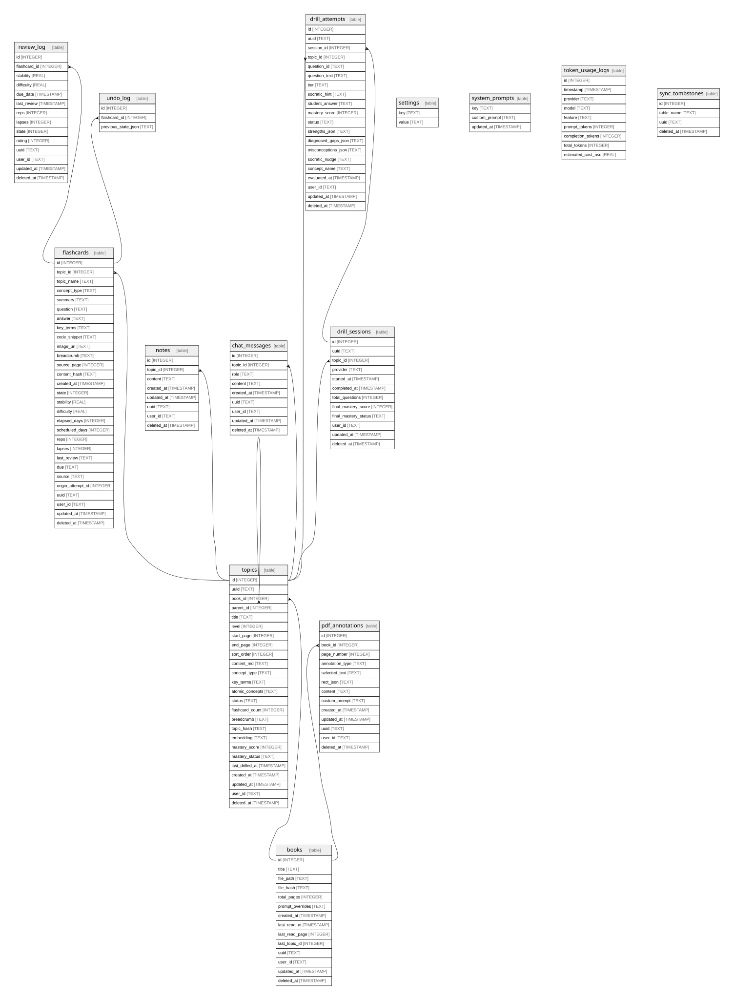

# Recall AI – legacy study DB (recall.db / user_<id>_recall.db)

## Tables

| Name                                    | Columns | Comment | Type  |
| --------------------------------------- | ------- | ------- | ----- |
| [books](books.md)                       | 14      |         | table |
| [topics](topics.md)                     | 25      |         | table |
| [flashcards](flashcards.md)             | 29      |         | table |
| [notes](notes.md)                       | 8       |         | table |
| [review_log](review_log.md)             | 14      |         | table |
| [settings](settings.md)                 | 2       |         | table |
| [chat_messages](chat_messages.md)       | 9       |         | table |
| [undo_log](undo_log.md)                 | 3       |         | table |
| [pdf_annotations](pdf_annotations.md)   | 13      |         | table |
| [system_prompts](system_prompts.md)     | 3       |         | table |
| [token_usage_logs](token_usage_logs.md) | 9       |         | table |
| [drill_sessions](drill_sessions.md)     | 12      |         | table |
| [drill_attempts](drill_attempts.md)     | 20      |         | table |
| [sync_tombstones](sync_tombstones.md)   | 4       |         | table |

## Relations

---

> Generated by [tbls](https://github.com/k1LoW/tbls)
