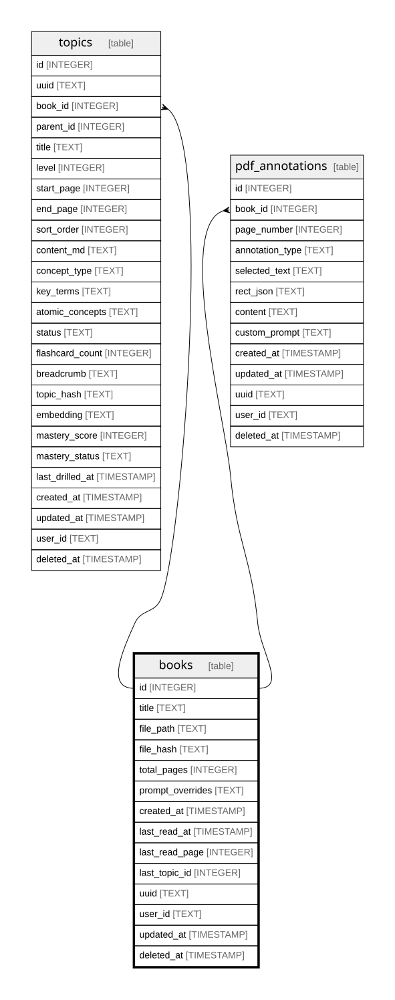

# books

## Description

<details>
<summary><strong>Table Definition</strong></summary>

```sql
CREATE TABLE books (
                id INTEGER PRIMARY KEY AUTOINCREMENT,
                title TEXT NOT NULL,
                file_path TEXT NOT NULL,
                file_hash TEXT UNIQUE NOT NULL,
                total_pages INTEGER NOT NULL,
                prompt_overrides TEXT,
                created_at TIMESTAMP DEFAULT CURRENT_TIMESTAMP
            , last_read_at TIMESTAMP, last_read_page INTEGER DEFAULT 1, last_topic_id INTEGER, uuid TEXT, user_id TEXT, updated_at TIMESTAMP, deleted_at TIMESTAMP)
```

</details>

## Columns

| Name             | Type      | Default           | Nullable | Children                                                  | Parents | Comment |
| ---------------- | --------- | ----------------- | -------- | --------------------------------------------------------- | ------- | ------- |
| id               | INTEGER   |                   | true     | [topics](topics.md) [pdf_annotations](pdf_annotations.md) |         |         |
| title            | TEXT      |                   | false    |                                                           |         |         |
| file_path        | TEXT      |                   | false    |                                                           |         |         |
| file_hash        | TEXT      |                   | false    |                                                           |         |         |
| total_pages      | INTEGER   |                   | false    |                                                           |         |         |
| prompt_overrides | TEXT      |                   | true     |                                                           |         |         |
| created_at       | TIMESTAMP | CURRENT_TIMESTAMP | true     |                                                           |         |         |
| last_read_at     | TIMESTAMP |                   | true     |                                                           |         |         |
| last_read_page   | INTEGER   | 1                 | true     |                                                           |         |         |
| last_topic_id    | INTEGER   |                   | true     |                                                           |         |         |
| uuid             | TEXT      |                   | true     |                                                           |         |         |
| user_id          | TEXT      |                   | true     |                                                           |         |         |
| updated_at       | TIMESTAMP |                   | true     |                                                           |         |         |
| deleted_at       | TIMESTAMP |                   | true     |                                                           |         |         |

## Constraints

| Name                     | Type        | Definition         |
| ------------------------ | ----------- | ------------------ |
| id                       | PRIMARY KEY | PRIMARY KEY (id)   |
| sqlite_autoindex_books_1 | UNIQUE      | UNIQUE (file_hash) |

## Indexes

| Name                     | Definition                                        |
| ------------------------ | ------------------------------------------------- |
| idx_books_uuid           | CREATE UNIQUE INDEX idx_books_uuid ON books(uuid) |
| sqlite_autoindex_books_1 | UNIQUE (file_hash)                                |

## Triggers

| Name                        | Definition                                                                                                                                                                                                                                                                                                                                                  |
| --------------------------- | ----------------------------------------------------------------------------------------------------------------------------------------------------------------------------------------------------------------------------------------------------------------------------------------------------------------------------------------------------------- |
| books_set_updated_at_insert | CREATE TRIGGER books_set_updated_at_insert<br />                AFTER INSERT ON books<br />                FOR EACH ROW<br />                WHEN NEW.updated_at IS NULL<br />                BEGIN<br />                    UPDATE books SET updated_at = CURRENT_TIMESTAMP WHERE id = NEW.id;<br />                END                                    |
| books_set_updated_at_update | CREATE TRIGGER books_set_updated_at_update<br />                AFTER UPDATE ON books<br />                FOR EACH ROW<br />                WHEN NEW.updated_at = OLD.updated_at OR NEW.updated_at IS NULL<br />                BEGIN<br />                    UPDATE books SET updated_at = CURRENT_TIMESTAMP WHERE id = NEW.id;<br />                END |
| books_record_tombstone      | CREATE TRIGGER books_record_tombstone<br />                BEFORE DELETE ON books<br />                FOR EACH ROW<br />                WHEN OLD.uuid IS NOT NULL<br />                BEGIN<br />                    INSERT INTO sync_tombstones (table_name, uuid) VALUES ('books', OLD.uuid);<br />                END                                  |

## Relations



---

> Generated by [tbls](https://github.com/k1LoW/tbls)
