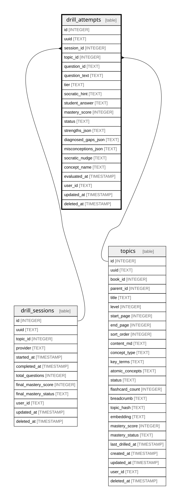

# drill_attempts

## Description

<details>
<summary><strong>Table Definition</strong></summary>

```sql
CREATE TABLE drill_attempts (
                id INTEGER PRIMARY KEY AUTOINCREMENT,
                uuid TEXT NOT NULL UNIQUE DEFAULT (
                    lower(hex(randomblob(4))) || '-' ||
                    lower(hex(randomblob(2))) || '-4' ||
                    substr(lower(hex(randomblob(2))), 2) || '-a' ||
                    substr(lower(hex(randomblob(2))), 2) || '-' ||
                    lower(hex(randomblob(6)))
                ),
                session_id INTEGER NOT NULL REFERENCES drill_sessions(id) ON DELETE CASCADE,
                topic_id INTEGER NOT NULL REFERENCES topics(id) ON DELETE CASCADE,
                question_id TEXT NOT NULL,
                question_text TEXT NOT NULL,
                tier TEXT NOT NULL,
                socratic_hint TEXT,
                student_answer TEXT NOT NULL,
                mastery_score INTEGER NOT NULL,
                status TEXT NOT NULL,
                strengths_json TEXT,
                diagnosed_gaps_json TEXT,
                misconceptions_json TEXT,
                socratic_nudge TEXT,
                concept_name TEXT,
                evaluated_at TIMESTAMP DEFAULT CURRENT_TIMESTAMP,
                user_id TEXT,
                updated_at TIMESTAMP DEFAULT CURRENT_TIMESTAMP,
                deleted_at TIMESTAMP
            )
```

</details>

## Columns

| Name                | Type      | Default                                                                                                                                                                                                                                                                                                               | Nullable | Children | Parents                             | Comment |
| ------------------- | --------- | --------------------------------------------------------------------------------------------------------------------------------------------------------------------------------------------------------------------------------------------------------------------------------------------------------------------- | -------- | -------- | ----------------------------------- | ------- |
| id                  | INTEGER   |                                                                                                                                                                                                                                                                                                                       | true     |          |                                     |         |
| uuid                | TEXT      | lower(hex(randomblob(4))) \|\| '-' \|\|<br />                    lower(hex(randomblob(2))) \|\| '-4' \|\|<br />                    substr(lower(hex(randomblob(2))), 2) \|\| '-a' \|\|<br />                    substr(lower(hex(randomblob(2))), 2) \|\| '-' \|\|<br />                    lower(hex(randomblob(6))) | false    |          |                                     |         |
| session_id          | INTEGER   |                                                                                                                                                                                                                                                                                                                       | false    |          | [drill_sessions](drill_sessions.md) |         |
| topic_id            | INTEGER   |                                                                                                                                                                                                                                                                                                                       | false    |          | [topics](topics.md)                 |         |
| question_id         | TEXT      |                                                                                                                                                                                                                                                                                                                       | false    |          |                                     |         |
| question_text       | TEXT      |                                                                                                                                                                                                                                                                                                                       | false    |          |                                     |         |
| tier                | TEXT      |                                                                                                                                                                                                                                                                                                                       | false    |          |                                     |         |
| socratic_hint       | TEXT      |                                                                                                                                                                                                                                                                                                                       | true     |          |                                     |         |
| student_answer      | TEXT      |                                                                                                                                                                                                                                                                                                                       | false    |          |                                     |         |
| mastery_score       | INTEGER   |                                                                                                                                                                                                                                                                                                                       | false    |          |                                     |         |
| status              | TEXT      |                                                                                                                                                                                                                                                                                                                       | false    |          |                                     |         |
| strengths_json      | TEXT      |                                                                                                                                                                                                                                                                                                                       | true     |          |                                     |         |
| diagnosed_gaps_json | TEXT      |                                                                                                                                                                                                                                                                                                                       | true     |          |                                     |         |
| misconceptions_json | TEXT      |                                                                                                                                                                                                                                                                                                                       | true     |          |                                     |         |
| socratic_nudge      | TEXT      |                                                                                                                                                                                                                                                                                                                       | true     |          |                                     |         |
| concept_name        | TEXT      |                                                                                                                                                                                                                                                                                                                       | true     |          |                                     |         |
| evaluated_at        | TIMESTAMP | CURRENT_TIMESTAMP                                                                                                                                                                                                                                                                                                     | true     |          |                                     |         |
| user_id             | TEXT      |                                                                                                                                                                                                                                                                                                                       | true     |          |                                     |         |
| updated_at          | TIMESTAMP | CURRENT_TIMESTAMP                                                                                                                                                                                                                                                                                                     | true     |          |                                     |         |
| deleted_at          | TIMESTAMP |                                                                                                                                                                                                                                                                                                                       | true     |          |                                     |         |

## Constraints

| Name                              | Type        | Definition                                                                                               |
| --------------------------------- | ----------- | -------------------------------------------------------------------------------------------------------- |
| id                                | PRIMARY KEY | PRIMARY KEY (id)                                                                                         |
| - (Foreign key ID: 0)             | FOREIGN KEY | FOREIGN KEY (topic_id) REFERENCES topics (id) ON UPDATE NO ACTION ON DELETE CASCADE MATCH NONE           |
| - (Foreign key ID: 1)             | FOREIGN KEY | FOREIGN KEY (session_id) REFERENCES drill_sessions (id) ON UPDATE NO ACTION ON DELETE CASCADE MATCH NONE |
| sqlite_autoindex_drill_attempts_1 | UNIQUE      | UNIQUE (uuid)                                                                                            |

## Indexes

| Name                              | Definition                                                            |
| --------------------------------- | --------------------------------------------------------------------- |
| idx_drill_attempts_topic          | CREATE INDEX idx_drill_attempts_topic ON drill_attempts(topic_id)     |
| idx_drill_attempts_session        | CREATE INDEX idx_drill_attempts_session ON drill_attempts(session_id) |
| idx_drill_attempts_uuid           | CREATE UNIQUE INDEX idx_drill_attempts_uuid ON drill_attempts(uuid)   |
| sqlite_autoindex_drill_attempts_1 | UNIQUE (uuid)                                                         |

## Triggers

| Name                                 | Definition                                                                                                                                                                                                                                                                                                                                                                                          |
| ------------------------------------ | --------------------------------------------------------------------------------------------------------------------------------------------------------------------------------------------------------------------------------------------------------------------------------------------------------------------------------------------------------------------------------------------------- |
| drill_attempts_set_updated_at_insert | CREATE TRIGGER drill_attempts_set_updated_at_insert<br />                AFTER INSERT ON drill_attempts<br />                FOR EACH ROW<br />                WHEN NEW.updated_at IS NULL<br />                BEGIN<br />                    UPDATE drill_attempts SET updated_at = CURRENT_TIMESTAMP WHERE id = NEW.id;<br />                END                                                 |
| drill_attempts_set_updated_at_update | CREATE TRIGGER drill_attempts_set_updated_at_update<br />                AFTER UPDATE ON drill_attempts<br />                FOR EACH ROW<br />                WHEN NEW.updated_at = OLD.updated_at OR NEW.updated_at IS NULL<br />                BEGIN<br />                    UPDATE drill_attempts SET updated_at = CURRENT_TIMESTAMP WHERE id = NEW.id;<br />                END              |
| drill_attempts_record_tombstone      | CREATE TRIGGER drill_attempts_record_tombstone<br />                BEFORE DELETE ON drill_attempts<br />                FOR EACH ROW<br />                WHEN OLD.uuid IS NOT NULL<br />                BEGIN<br />                    INSERT INTO sync_tombstones (table_name, uuid) VALUES ('drill_attempts', OLD.uuid);<br />                END                                               |
| topics_apply_drill_result            | CREATE TRIGGER topics_apply_drill_result<br />            AFTER INSERT ON drill_attempts<br />            BEGIN<br />                UPDATE topics<br />                SET mastery_score = NEW.mastery_score,<br />                    mastery_status = NEW.status,<br />                    last_drilled_at = NEW.evaluated_at<br />                WHERE id = NEW.topic_id;<br />            END |

## Relations



---

> Generated by [tbls](https://github.com/k1LoW/tbls)
