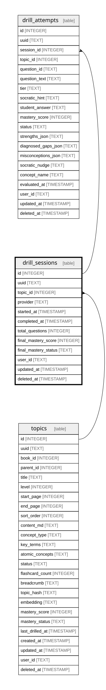

# drill_sessions

## Description

<details>
<summary><strong>Table Definition</strong></summary>

```sql
CREATE TABLE drill_sessions (
                id INTEGER PRIMARY KEY AUTOINCREMENT,
                uuid TEXT NOT NULL UNIQUE DEFAULT (
                    lower(hex(randomblob(4))) || '-' ||
                    lower(hex(randomblob(2))) || '-4' ||
                    substr(lower(hex(randomblob(2))), 2) || '-a' ||
                    substr(lower(hex(randomblob(2))), 2) || '-' ||
                    lower(hex(randomblob(6)))
                ),
                topic_id INTEGER NOT NULL REFERENCES topics(id) ON DELETE CASCADE,
                provider TEXT,
                started_at TIMESTAMP DEFAULT CURRENT_TIMESTAMP,
                completed_at TIMESTAMP,
                total_questions INTEGER DEFAULT 0,
                final_mastery_score INTEGER,
                final_mastery_status TEXT,
                user_id TEXT,
                updated_at TIMESTAMP DEFAULT CURRENT_TIMESTAMP,
                deleted_at TIMESTAMP
            )
```

</details>

## Columns

| Name                 | Type      | Default                                                                                                                                                                                                                                                                                                               | Nullable | Children                            | Parents             | Comment |
| -------------------- | --------- | --------------------------------------------------------------------------------------------------------------------------------------------------------------------------------------------------------------------------------------------------------------------------------------------------------------------- | -------- | ----------------------------------- | ------------------- | ------- |
| id                   | INTEGER   |                                                                                                                                                                                                                                                                                                                       | true     | [drill_attempts](drill_attempts.md) |                     |         |
| uuid                 | TEXT      | lower(hex(randomblob(4))) \|\| '-' \|\|<br />                    lower(hex(randomblob(2))) \|\| '-4' \|\|<br />                    substr(lower(hex(randomblob(2))), 2) \|\| '-a' \|\|<br />                    substr(lower(hex(randomblob(2))), 2) \|\| '-' \|\|<br />                    lower(hex(randomblob(6))) | false    |                                     |                     |         |
| topic_id             | INTEGER   |                                                                                                                                                                                                                                                                                                                       | false    |                                     | [topics](topics.md) |         |
| provider             | TEXT      |                                                                                                                                                                                                                                                                                                                       | true     |                                     |                     |         |
| started_at           | TIMESTAMP | CURRENT_TIMESTAMP                                                                                                                                                                                                                                                                                                     | true     |                                     |                     |         |
| completed_at         | TIMESTAMP |                                                                                                                                                                                                                                                                                                                       | true     |                                     |                     |         |
| total_questions      | INTEGER   | 0                                                                                                                                                                                                                                                                                                                     | true     |                                     |                     |         |
| final_mastery_score  | INTEGER   |                                                                                                                                                                                                                                                                                                                       | true     |                                     |                     |         |
| final_mastery_status | TEXT      |                                                                                                                                                                                                                                                                                                                       | true     |                                     |                     |         |
| user_id              | TEXT      |                                                                                                                                                                                                                                                                                                                       | true     |                                     |                     |         |
| updated_at           | TIMESTAMP | CURRENT_TIMESTAMP                                                                                                                                                                                                                                                                                                     | true     |                                     |                     |         |
| deleted_at           | TIMESTAMP |                                                                                                                                                                                                                                                                                                                       | true     |                                     |                     |         |

## Constraints

| Name                              | Type        | Definition                                                                                     |
| --------------------------------- | ----------- | ---------------------------------------------------------------------------------------------- |
| id                                | PRIMARY KEY | PRIMARY KEY (id)                                                                               |
| - (Foreign key ID: 0)             | FOREIGN KEY | FOREIGN KEY (topic_id) REFERENCES topics (id) ON UPDATE NO ACTION ON DELETE CASCADE MATCH NONE |
| sqlite_autoindex_drill_sessions_1 | UNIQUE      | UNIQUE (uuid)                                                                                  |

## Indexes

| Name                              | Definition                                                           |
| --------------------------------- | -------------------------------------------------------------------- |
| idx_drill_sessions_topic_id       | CREATE INDEX idx_drill_sessions_topic_id ON drill_sessions(topic_id) |
| idx_drill_sessions_uuid           | CREATE UNIQUE INDEX idx_drill_sessions_uuid ON drill_sessions(uuid)  |
| sqlite_autoindex_drill_sessions_1 | UNIQUE (uuid)                                                        |

## Triggers

| Name                                 | Definition                                                                                                                                                                                                                                                                                                                                                                             |
| ------------------------------------ | -------------------------------------------------------------------------------------------------------------------------------------------------------------------------------------------------------------------------------------------------------------------------------------------------------------------------------------------------------------------------------------- |
| drill_sessions_set_updated_at_insert | CREATE TRIGGER drill_sessions_set_updated_at_insert<br />                AFTER INSERT ON drill_sessions<br />                FOR EACH ROW<br />                WHEN NEW.updated_at IS NULL<br />                BEGIN<br />                    UPDATE drill_sessions SET updated_at = CURRENT_TIMESTAMP WHERE id = NEW.id;<br />                END                                    |
| drill_sessions_set_updated_at_update | CREATE TRIGGER drill_sessions_set_updated_at_update<br />                AFTER UPDATE ON drill_sessions<br />                FOR EACH ROW<br />                WHEN NEW.updated_at = OLD.updated_at OR NEW.updated_at IS NULL<br />                BEGIN<br />                    UPDATE drill_sessions SET updated_at = CURRENT_TIMESTAMP WHERE id = NEW.id;<br />                END |
| drill_sessions_record_tombstone      | CREATE TRIGGER drill_sessions_record_tombstone<br />                BEFORE DELETE ON drill_sessions<br />                FOR EACH ROW<br />                WHEN OLD.uuid IS NOT NULL<br />                BEGIN<br />                    INSERT INTO sync_tombstones (table_name, uuid) VALUES ('drill_sessions', OLD.uuid);<br />                END                                  |

## Relations



---

> Generated by [tbls](https://github.com/k1LoW/tbls)
