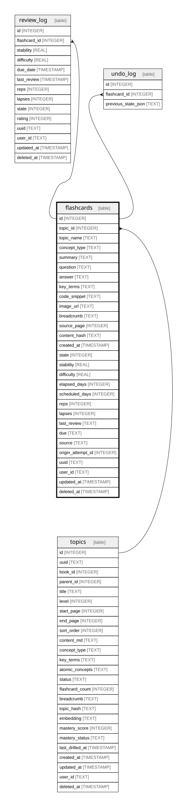

# flashcards

## Description

<details>
<summary><strong>Table Definition</strong></summary>

```sql
CREATE TABLE flashcards (
                id INTEGER PRIMARY KEY AUTOINCREMENT,
                topic_id INTEGER NOT NULL,
                topic_name TEXT NOT NULL,
                concept_type TEXT NOT NULL,
                summary TEXT NOT NULL,
                question TEXT NOT NULL,
                answer TEXT NOT NULL,
                key_terms TEXT NOT NULL,
                code_snippet TEXT,
                image_url TEXT,
                breadcrumb TEXT,
                source_page INTEGER,
                content_hash TEXT NOT NULL,
                created_at TIMESTAMP DEFAULT CURRENT_TIMESTAMP, state INTEGER DEFAULT 0, stability REAL DEFAULT 0.0, difficulty REAL DEFAULT 0.0, elapsed_days INTEGER DEFAULT 0, scheduled_days INTEGER DEFAULT 0, reps INTEGER DEFAULT 0, lapses INTEGER DEFAULT 0, last_review TEXT, due TEXT, source TEXT DEFAULT 'extraction', origin_attempt_id INTEGER, uuid TEXT, user_id TEXT, updated_at TIMESTAMP, deleted_at TIMESTAMP,
                FOREIGN KEY (topic_id) REFERENCES topics (id) ON DELETE CASCADE,
                UNIQUE(topic_id, content_hash)
            )
```

</details>

## Columns

| Name              | Type      | Default           | Nullable | Children                                            | Parents             | Comment |
| ----------------- | --------- | ----------------- | -------- | --------------------------------------------------- | ------------------- | ------- |
| id                | INTEGER   |                   | true     | [review_log](review_log.md) [undo_log](undo_log.md) |                     |         |
| topic_id          | INTEGER   |                   | false    |                                                     | [topics](topics.md) |         |
| topic_name        | TEXT      |                   | false    |                                                     |                     |         |
| concept_type      | TEXT      |                   | false    |                                                     |                     |         |
| summary           | TEXT      |                   | false    |                                                     |                     |         |
| question          | TEXT      |                   | false    |                                                     |                     |         |
| answer            | TEXT      |                   | false    |                                                     |                     |         |
| key_terms         | TEXT      |                   | false    |                                                     |                     |         |
| code_snippet      | TEXT      |                   | true     |                                                     |                     |         |
| image_url         | TEXT      |                   | true     |                                                     |                     |         |
| breadcrumb        | TEXT      |                   | true     |                                                     |                     |         |
| source_page       | INTEGER   |                   | true     |                                                     |                     |         |
| content_hash      | TEXT      |                   | false    |                                                     |                     |         |
| created_at        | TIMESTAMP | CURRENT_TIMESTAMP | true     |                                                     |                     |         |
| state             | INTEGER   | 0                 | true     |                                                     |                     |         |
| stability         | REAL      | 0.0               | true     |                                                     |                     |         |
| difficulty        | REAL      | 0.0               | true     |                                                     |                     |         |
| elapsed_days      | INTEGER   | 0                 | true     |                                                     |                     |         |
| scheduled_days    | INTEGER   | 0                 | true     |                                                     |                     |         |
| reps              | INTEGER   | 0                 | true     |                                                     |                     |         |
| lapses            | INTEGER   | 0                 | true     |                                                     |                     |         |
| last_review       | TEXT      |                   | true     |                                                     |                     |         |
| due               | TEXT      |                   | true     |                                                     |                     |         |
| source            | TEXT      | 'extraction'      | true     |                                                     |                     |         |
| origin_attempt_id | INTEGER   |                   | true     |                                                     |                     |         |
| uuid              | TEXT      |                   | true     |                                                     |                     |         |
| user_id           | TEXT      |                   | true     |                                                     |                     |         |
| updated_at        | TIMESTAMP |                   | true     |                                                     |                     |         |
| deleted_at        | TIMESTAMP |                   | true     |                                                     |                     |         |

## Constraints

| Name                          | Type        | Definition                                                                                     |
| ----------------------------- | ----------- | ---------------------------------------------------------------------------------------------- |
| id                            | PRIMARY KEY | PRIMARY KEY (id)                                                                               |
| - (Foreign key ID: 0)         | FOREIGN KEY | FOREIGN KEY (topic_id) REFERENCES topics (id) ON UPDATE NO ACTION ON DELETE CASCADE MATCH NONE |
| sqlite_autoindex_flashcards_1 | UNIQUE      | UNIQUE (topic_id, content_hash)                                                                |

## Indexes

| Name                          | Definition                                                   |
| ----------------------------- | ------------------------------------------------------------ |
| idx_flashcards_due            | CREATE INDEX idx_flashcards_due ON flashcards(due)           |
| idx_flashcards_topic_id       | CREATE INDEX idx_flashcards_topic_id ON flashcards(topic_id) |
| idx_flashcards_uuid           | CREATE UNIQUE INDEX idx_flashcards_uuid ON flashcards(uuid)  |
| sqlite_autoindex_flashcards_1 | UNIQUE (topic_id, content_hash)                              |

## Triggers

| Name                             | Definition                                                                                                                                                                                                                                                                                                                                                                 |
| -------------------------------- | -------------------------------------------------------------------------------------------------------------------------------------------------------------------------------------------------------------------------------------------------------------------------------------------------------------------------------------------------------------------------- |
| flashcards_set_updated_at_insert | CREATE TRIGGER flashcards_set_updated_at_insert<br />                AFTER INSERT ON flashcards<br />                FOR EACH ROW<br />                WHEN NEW.updated_at IS NULL<br />                BEGIN<br />                    UPDATE flashcards SET updated_at = CURRENT_TIMESTAMP WHERE id = NEW.id;<br />                END                                    |
| flashcards_set_updated_at_update | CREATE TRIGGER flashcards_set_updated_at_update<br />                AFTER UPDATE ON flashcards<br />                FOR EACH ROW<br />                WHEN NEW.updated_at = OLD.updated_at OR NEW.updated_at IS NULL<br />                BEGIN<br />                    UPDATE flashcards SET updated_at = CURRENT_TIMESTAMP WHERE id = NEW.id;<br />                END |
| flashcards_record_tombstone      | CREATE TRIGGER flashcards_record_tombstone<br />                BEFORE DELETE ON flashcards<br />                FOR EACH ROW<br />                WHEN OLD.uuid IS NOT NULL<br />                BEGIN<br />                    INSERT INTO sync_tombstones (table_name, uuid) VALUES ('flashcards', OLD.uuid);<br />                END                                  |
| flashcards_count_after_insert    | CREATE TRIGGER flashcards_count_after_insert<br />            AFTER INSERT ON flashcards<br />            BEGIN<br />                UPDATE topics<br />                SET flashcard_count = (SELECT COUNT(*) FROM flashcards WHERE topic_id = NEW.topic_id)<br />                WHERE id = NEW.topic_id;<br />            END                                           |
| flashcards_count_after_delete    | CREATE TRIGGER flashcards_count_after_delete<br />            AFTER DELETE ON flashcards<br />            BEGIN<br />                UPDATE topics<br />                SET flashcard_count = (SELECT COUNT(*) FROM flashcards WHERE topic_id = OLD.topic_id)<br />                WHERE id = OLD.topic_id;<br />            END                                           |

## Relations



---

> Generated by [tbls](https://github.com/k1LoW/tbls)
