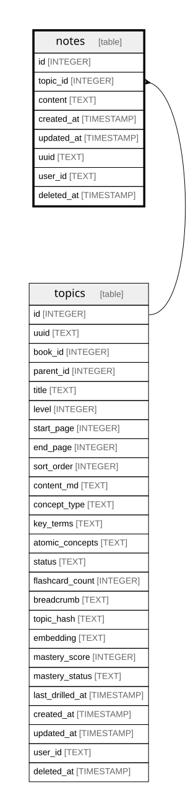

# notes

## Description

<details>
<summary><strong>Table Definition</strong></summary>

```sql
CREATE TABLE notes (
                id INTEGER PRIMARY KEY AUTOINCREMENT,
                topic_id INTEGER NOT NULL,
                content TEXT NOT NULL,
                created_at TIMESTAMP DEFAULT CURRENT_TIMESTAMP,
                updated_at TIMESTAMP DEFAULT CURRENT_TIMESTAMP, uuid TEXT, user_id TEXT, deleted_at TIMESTAMP,
                FOREIGN KEY (topic_id) REFERENCES topics (id) ON DELETE CASCADE
            )
```

</details>

## Columns

| Name       | Type      | Default           | Nullable | Children | Parents             | Comment |
| ---------- | --------- | ----------------- | -------- | -------- | ------------------- | ------- |
| id         | INTEGER   |                   | true     |          |                     |         |
| topic_id   | INTEGER   |                   | false    |          | [topics](topics.md) |         |
| content    | TEXT      |                   | false    |          |                     |         |
| created_at | TIMESTAMP | CURRENT_TIMESTAMP | true     |          |                     |         |
| updated_at | TIMESTAMP | CURRENT_TIMESTAMP | true     |          |                     |         |
| uuid       | TEXT      |                   | true     |          |                     |         |
| user_id    | TEXT      |                   | true     |          |                     |         |
| deleted_at | TIMESTAMP |                   | true     |          |                     |         |

## Constraints

| Name                  | Type        | Definition                                                                                     |
| --------------------- | ----------- | ---------------------------------------------------------------------------------------------- |
| id                    | PRIMARY KEY | PRIMARY KEY (id)                                                                               |
| - (Foreign key ID: 0) | FOREIGN KEY | FOREIGN KEY (topic_id) REFERENCES topics (id) ON UPDATE NO ACTION ON DELETE CASCADE MATCH NONE |

## Indexes

| Name               | Definition                                         |
| ------------------ | -------------------------------------------------- |
| idx_notes_topic_id | CREATE INDEX idx_notes_topic_id ON notes(topic_id) |
| idx_notes_uuid     | CREATE UNIQUE INDEX idx_notes_uuid ON notes(uuid)  |

## Triggers

| Name                        | Definition                                                                                                                                                                                                                                                                                                                                                  |
| --------------------------- | ----------------------------------------------------------------------------------------------------------------------------------------------------------------------------------------------------------------------------------------------------------------------------------------------------------------------------------------------------------- |
| notes_set_updated_at_insert | CREATE TRIGGER notes_set_updated_at_insert<br />                AFTER INSERT ON notes<br />                FOR EACH ROW<br />                WHEN NEW.updated_at IS NULL<br />                BEGIN<br />                    UPDATE notes SET updated_at = CURRENT_TIMESTAMP WHERE id = NEW.id;<br />                END                                    |
| notes_set_updated_at_update | CREATE TRIGGER notes_set_updated_at_update<br />                AFTER UPDATE ON notes<br />                FOR EACH ROW<br />                WHEN NEW.updated_at = OLD.updated_at OR NEW.updated_at IS NULL<br />                BEGIN<br />                    UPDATE notes SET updated_at = CURRENT_TIMESTAMP WHERE id = NEW.id;<br />                END |
| notes_record_tombstone      | CREATE TRIGGER notes_record_tombstone<br />                BEFORE DELETE ON notes<br />                FOR EACH ROW<br />                WHEN OLD.uuid IS NOT NULL<br />                BEGIN<br />                    INSERT INTO sync_tombstones (table_name, uuid) VALUES ('notes', OLD.uuid);<br />                END                                  |

## Relations



---

> Generated by [tbls](https://github.com/k1LoW/tbls)
