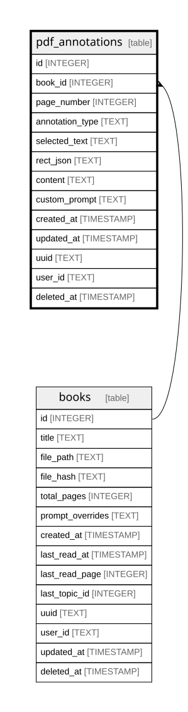

# pdf_annotations

## Description

<details>
<summary><strong>Table Definition</strong></summary>

```sql
CREATE TABLE pdf_annotations (
                id INTEGER PRIMARY KEY AUTOINCREMENT,
                book_id INTEGER NOT NULL,
                page_number INTEGER NOT NULL,
                annotation_type TEXT NOT NULL,
                selected_text TEXT NOT NULL,
                rect_json TEXT NOT NULL,
                content TEXT,
                custom_prompt TEXT,
                created_at TIMESTAMP DEFAULT CURRENT_TIMESTAMP,
                updated_at TIMESTAMP DEFAULT CURRENT_TIMESTAMP, uuid TEXT, user_id TEXT, deleted_at TIMESTAMP,
                FOREIGN KEY (book_id) REFERENCES books (id) ON DELETE CASCADE
            )
```

</details>

## Columns

| Name            | Type      | Default           | Nullable | Children | Parents           | Comment |
| --------------- | --------- | ----------------- | -------- | -------- | ----------------- | ------- |
| id              | INTEGER   |                   | true     |          |                   |         |
| book_id         | INTEGER   |                   | false    |          | [books](books.md) |         |
| page_number     | INTEGER   |                   | false    |          |                   |         |
| annotation_type | TEXT      |                   | false    |          |                   |         |
| selected_text   | TEXT      |                   | false    |          |                   |         |
| rect_json       | TEXT      |                   | false    |          |                   |         |
| content         | TEXT      |                   | true     |          |                   |         |
| custom_prompt   | TEXT      |                   | true     |          |                   |         |
| created_at      | TIMESTAMP | CURRENT_TIMESTAMP | true     |          |                   |         |
| updated_at      | TIMESTAMP | CURRENT_TIMESTAMP | true     |          |                   |         |
| uuid            | TEXT      |                   | true     |          |                   |         |
| user_id         | TEXT      |                   | true     |          |                   |         |
| deleted_at      | TIMESTAMP |                   | true     |          |                   |         |

## Constraints

| Name                  | Type        | Definition                                                                                   |
| --------------------- | ----------- | -------------------------------------------------------------------------------------------- |
| id                    | PRIMARY KEY | PRIMARY KEY (id)                                                                             |
| - (Foreign key ID: 0) | FOREIGN KEY | FOREIGN KEY (book_id) REFERENCES books (id) ON UPDATE NO ACTION ON DELETE CASCADE MATCH NONE |

## Indexes

| Name                     | Definition                                                            |
| ------------------------ | --------------------------------------------------------------------- |
| idx_pdf_annotations_uuid | CREATE UNIQUE INDEX idx_pdf_annotations_uuid ON pdf_annotations(uuid) |

## Triggers

| Name                                  | Definition                                                                                                                                                                                                                                                                                                                                                                                |
| ------------------------------------- | ----------------------------------------------------------------------------------------------------------------------------------------------------------------------------------------------------------------------------------------------------------------------------------------------------------------------------------------------------------------------------------------- |
| pdf_annotations_set_updated_at_insert | CREATE TRIGGER pdf_annotations_set_updated_at_insert<br />                AFTER INSERT ON pdf_annotations<br />                FOR EACH ROW<br />                WHEN NEW.updated_at IS NULL<br />                BEGIN<br />                    UPDATE pdf_annotations SET updated_at = CURRENT_TIMESTAMP WHERE id = NEW.id;<br />                END                                    |
| pdf_annotations_set_updated_at_update | CREATE TRIGGER pdf_annotations_set_updated_at_update<br />                AFTER UPDATE ON pdf_annotations<br />                FOR EACH ROW<br />                WHEN NEW.updated_at = OLD.updated_at OR NEW.updated_at IS NULL<br />                BEGIN<br />                    UPDATE pdf_annotations SET updated_at = CURRENT_TIMESTAMP WHERE id = NEW.id;<br />                END |
| pdf_annotations_record_tombstone      | CREATE TRIGGER pdf_annotations_record_tombstone<br />                BEFORE DELETE ON pdf_annotations<br />                FOR EACH ROW<br />                WHEN OLD.uuid IS NOT NULL<br />                BEGIN<br />                    INSERT INTO sync_tombstones (table_name, uuid) VALUES ('pdf_annotations', OLD.uuid);<br />                END                                  |

## Relations



---

> Generated by [tbls](https://github.com/k1LoW/tbls)
