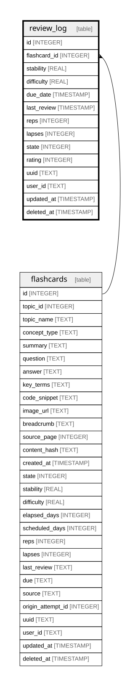

# review_log

## Description

<details>
<summary><strong>Table Definition</strong></summary>

```sql
CREATE TABLE review_log (
                id INTEGER PRIMARY KEY AUTOINCREMENT,
                flashcard_id INTEGER NOT NULL,
                stability REAL NOT NULL,
                difficulty REAL NOT NULL,
                due_date TIMESTAMP NOT NULL,
                last_review TIMESTAMP,
                reps INTEGER DEFAULT 0,
                lapses INTEGER DEFAULT 0,
                state INTEGER DEFAULT 0,
                rating INTEGER, uuid TEXT, user_id TEXT, updated_at TIMESTAMP, deleted_at TIMESTAMP,
                FOREIGN KEY (flashcard_id) REFERENCES flashcards (id) ON DELETE CASCADE
            )
```

</details>

## Columns

| Name         | Type      | Default | Nullable | Children | Parents                     | Comment |
| ------------ | --------- | ------- | -------- | -------- | --------------------------- | ------- |
| id           | INTEGER   |         | true     |          |                             |         |
| flashcard_id | INTEGER   |         | false    |          | [flashcards](flashcards.md) |         |
| stability    | REAL      |         | false    |          |                             |         |
| difficulty   | REAL      |         | false    |          |                             |         |
| due_date     | TIMESTAMP |         | false    |          |                             |         |
| last_review  | TIMESTAMP |         | true     |          |                             |         |
| reps         | INTEGER   | 0       | true     |          |                             |         |
| lapses       | INTEGER   | 0       | true     |          |                             |         |
| state        | INTEGER   | 0       | true     |          |                             |         |
| rating       | INTEGER   |         | true     |          |                             |         |
| uuid         | TEXT      |         | true     |          |                             |         |
| user_id      | TEXT      |         | true     |          |                             |         |
| updated_at   | TIMESTAMP |         | true     |          |                             |         |
| deleted_at   | TIMESTAMP |         | true     |          |                             |         |

## Constraints

| Name                  | Type        | Definition                                                                                             |
| --------------------- | ----------- | ------------------------------------------------------------------------------------------------------ |
| id                    | PRIMARY KEY | PRIMARY KEY (id)                                                                                       |
| - (Foreign key ID: 0) | FOREIGN KEY | FOREIGN KEY (flashcard_id) REFERENCES flashcards (id) ON UPDATE NO ACTION ON DELETE CASCADE MATCH NONE |

## Indexes

| Name                | Definition                                                  |
| ------------------- | ----------------------------------------------------------- |
| idx_review_log_uuid | CREATE UNIQUE INDEX idx_review_log_uuid ON review_log(uuid) |

## Triggers

| Name                             | Definition                                                                                                                                                                                                                                                                                                                                                                 |
| -------------------------------- | -------------------------------------------------------------------------------------------------------------------------------------------------------------------------------------------------------------------------------------------------------------------------------------------------------------------------------------------------------------------------- |
| review_log_set_updated_at_insert | CREATE TRIGGER review_log_set_updated_at_insert<br />                AFTER INSERT ON review_log<br />                FOR EACH ROW<br />                WHEN NEW.updated_at IS NULL<br />                BEGIN<br />                    UPDATE review_log SET updated_at = CURRENT_TIMESTAMP WHERE id = NEW.id;<br />                END                                    |
| review_log_set_updated_at_update | CREATE TRIGGER review_log_set_updated_at_update<br />                AFTER UPDATE ON review_log<br />                FOR EACH ROW<br />                WHEN NEW.updated_at = OLD.updated_at OR NEW.updated_at IS NULL<br />                BEGIN<br />                    UPDATE review_log SET updated_at = CURRENT_TIMESTAMP WHERE id = NEW.id;<br />                END |
| review_log_record_tombstone      | CREATE TRIGGER review_log_record_tombstone<br />                BEFORE DELETE ON review_log<br />                FOR EACH ROW<br />                WHEN OLD.uuid IS NOT NULL<br />                BEGIN<br />                    INSERT INTO sync_tombstones (table_name, uuid) VALUES ('review_log', OLD.uuid);<br />                END                                  |

## Relations



---

> Generated by [tbls](https://github.com/k1LoW/tbls)
