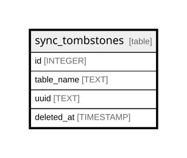

# sync_tombstones

## Description

<details>
<summary><strong>Table Definition</strong></summary>

```sql
CREATE TABLE sync_tombstones (
                id INTEGER PRIMARY KEY AUTOINCREMENT,
                table_name TEXT NOT NULL,
                uuid TEXT NOT NULL,
                deleted_at TIMESTAMP DEFAULT CURRENT_TIMESTAMP
            )
```

</details>

## Columns

| Name       | Type      | Default           | Nullable | Children | Parents | Comment |
| ---------- | --------- | ----------------- | -------- | -------- | ------- | ------- |
| id         | INTEGER   |                   | true     |          |         |         |
| table_name | TEXT      |                   | false    |          |         |         |
| uuid       | TEXT      |                   | false    |          |         |         |
| deleted_at | TIMESTAMP | CURRENT_TIMESTAMP | true     |          |         |         |

## Constraints

| Name | Type        | Definition       |
| ---- | ----------- | ---------------- |
| id   | PRIMARY KEY | PRIMARY KEY (id) |

## Relations



---

> Generated by [tbls](https://github.com/k1LoW/tbls)
