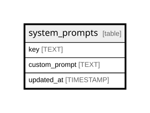

# system_prompts

## Description

<details>
<summary><strong>Table Definition</strong></summary>

```sql
CREATE TABLE system_prompts (
                key TEXT PRIMARY KEY,
                custom_prompt TEXT NOT NULL,
                updated_at TIMESTAMP DEFAULT CURRENT_TIMESTAMP
            )
```

</details>

## Columns

| Name          | Type      | Default           | Nullable | Children | Parents | Comment |
| ------------- | --------- | ----------------- | -------- | -------- | ------- | ------- |
| key           | TEXT      |                   | true     |          |         |         |
| custom_prompt | TEXT      |                   | false    |          |         |         |
| updated_at    | TIMESTAMP | CURRENT_TIMESTAMP | true     |          |         |         |

## Constraints

| Name                              | Type        | Definition        |
| --------------------------------- | ----------- | ----------------- |
| key                               | PRIMARY KEY | PRIMARY KEY (key) |
| sqlite_autoindex_system_prompts_1 | PRIMARY KEY | PRIMARY KEY (key) |

## Indexes

| Name                              | Definition        |
| --------------------------------- | ----------------- |
| sqlite_autoindex_system_prompts_1 | PRIMARY KEY (key) |

## Relations



---

> Generated by [tbls](https://github.com/k1LoW/tbls)
