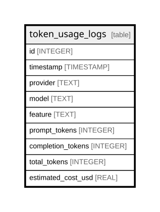

# token_usage_logs

## Description

<details>
<summary><strong>Table Definition</strong></summary>

```sql
CREATE TABLE token_usage_logs (
                id INTEGER PRIMARY KEY AUTOINCREMENT,
                timestamp TIMESTAMP DEFAULT CURRENT_TIMESTAMP,
                provider TEXT NOT NULL,
                model TEXT NOT NULL,
                feature TEXT NOT NULL,
                prompt_tokens INTEGER NOT NULL DEFAULT 0,
                completion_tokens INTEGER NOT NULL DEFAULT 0,
                total_tokens INTEGER NOT NULL DEFAULT 0,
                estimated_cost_usd REAL DEFAULT 0.0
            )
```

</details>

## Columns

| Name               | Type      | Default           | Nullable | Children | Parents | Comment |
| ------------------ | --------- | ----------------- | -------- | -------- | ------- | ------- |
| id                 | INTEGER   |                   | true     |          |         |         |
| timestamp          | TIMESTAMP | CURRENT_TIMESTAMP | true     |          |         |         |
| provider           | TEXT      |                   | false    |          |         |         |
| model              | TEXT      |                   | false    |          |         |         |
| feature            | TEXT      |                   | false    |          |         |         |
| prompt_tokens      | INTEGER   | 0                 | false    |          |         |         |
| completion_tokens  | INTEGER   | 0                 | false    |          |         |         |
| total_tokens       | INTEGER   | 0                 | false    |          |         |         |
| estimated_cost_usd | REAL      | 0.0               | true     |          |         |         |

## Constraints

| Name | Type        | Definition       |
| ---- | ----------- | ---------------- |
| id   | PRIMARY KEY | PRIMARY KEY (id) |

## Indexes

| Name                | Definition                                                      |
| ------------------- | --------------------------------------------------------------- |
| idx_usage_provider  | CREATE INDEX idx_usage_provider ON token_usage_logs(provider)   |
| idx_usage_feature   | CREATE INDEX idx_usage_feature ON token_usage_logs(feature)     |
| idx_usage_timestamp | CREATE INDEX idx_usage_timestamp ON token_usage_logs(timestamp) |

## Relations



---

> Generated by [tbls](https://github.com/k1LoW/tbls)
