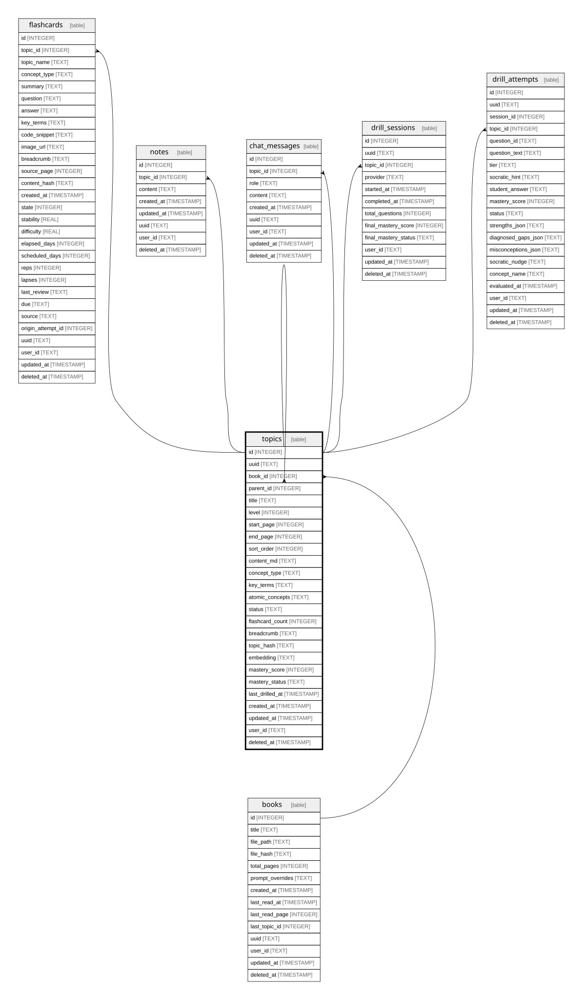

# topics

## Description

<details>
<summary><strong>Table Definition</strong></summary>

```sql
CREATE TABLE topics (
                id INTEGER PRIMARY KEY AUTOINCREMENT,
                uuid TEXT NOT NULL UNIQUE DEFAULT (
                    lower(hex(randomblob(4))) || '-' ||
                    lower(hex(randomblob(2))) || '-4' ||
                    substr(lower(hex(randomblob(2))), 2) || '-a' ||
                    substr(lower(hex(randomblob(2))), 2) || '-' ||
                    lower(hex(randomblob(6)))
                ),
                book_id INTEGER NOT NULL,
                parent_id INTEGER,
                title TEXT NOT NULL,
                level INTEGER NOT NULL,
                start_page INTEGER NOT NULL,
                end_page INTEGER NOT NULL,
                sort_order INTEGER NOT NULL,
                content_md TEXT,
                concept_type TEXT,
                key_terms TEXT,
                atomic_concepts TEXT,
                status TEXT DEFAULT 'unprocessed',
                flashcard_count INTEGER DEFAULT 0,
                breadcrumb TEXT,
                topic_hash TEXT UNIQUE NOT NULL,
                embedding TEXT,
                mastery_score INTEGER,
                mastery_status TEXT DEFAULT 'untested' CHECK (mastery_status IN ('untested', 'mastered', 'developing', 'fragile', 'misconception')),
                last_drilled_at TIMESTAMP,
                created_at TIMESTAMP DEFAULT CURRENT_TIMESTAMP,
                updated_at TIMESTAMP,
                user_id TEXT,
                deleted_at TIMESTAMP,
                FOREIGN KEY (book_id) REFERENCES books (id) ON DELETE CASCADE,
                FOREIGN KEY (parent_id) REFERENCES topics (id) ON DELETE CASCADE
            )
```

</details>

## Columns

| Name            | Type      | Default                                                                                                                                                                                                                                                                                                               | Nullable | Children                                                                                                                                                                    | Parents             | Comment |
| --------------- | --------- | --------------------------------------------------------------------------------------------------------------------------------------------------------------------------------------------------------------------------------------------------------------------------------------------------------------------- | -------- | --------------------------------------------------------------------------------------------------------------------------------------------------------------------------- | ------------------- | ------- |
| id              | INTEGER   |                                                                                                                                                                                                                                                                                                                       | true     | [topics](topics.md) [flashcards](flashcards.md) [notes](notes.md) [chat_messages](chat_messages.md) [drill_sessions](drill_sessions.md) [drill_attempts](drill_attempts.md) |                     |         |
| uuid            | TEXT      | lower(hex(randomblob(4))) \|\| '-' \|\|<br />                    lower(hex(randomblob(2))) \|\| '-4' \|\|<br />                    substr(lower(hex(randomblob(2))), 2) \|\| '-a' \|\|<br />                    substr(lower(hex(randomblob(2))), 2) \|\| '-' \|\|<br />                    lower(hex(randomblob(6))) | false    |                                                                                                                                                                             |                     |         |
| book_id         | INTEGER   |                                                                                                                                                                                                                                                                                                                       | false    |                                                                                                                                                                             | [books](books.md)   |         |
| parent_id       | INTEGER   |                                                                                                                                                                                                                                                                                                                       | true     |                                                                                                                                                                             | [topics](topics.md) |         |
| title           | TEXT      |                                                                                                                                                                                                                                                                                                                       | false    |                                                                                                                                                                             |                     |         |
| level           | INTEGER   |                                                                                                                                                                                                                                                                                                                       | false    |                                                                                                                                                                             |                     |         |
| start_page      | INTEGER   |                                                                                                                                                                                                                                                                                                                       | false    |                                                                                                                                                                             |                     |         |
| end_page        | INTEGER   |                                                                                                                                                                                                                                                                                                                       | false    |                                                                                                                                                                             |                     |         |
| sort_order      | INTEGER   |                                                                                                                                                                                                                                                                                                                       | false    |                                                                                                                                                                             |                     |         |
| content_md      | TEXT      |                                                                                                                                                                                                                                                                                                                       | true     |                                                                                                                                                                             |                     |         |
| concept_type    | TEXT      |                                                                                                                                                                                                                                                                                                                       | true     |                                                                                                                                                                             |                     |         |
| key_terms       | TEXT      |                                                                                                                                                                                                                                                                                                                       | true     |                                                                                                                                                                             |                     |         |
| atomic_concepts | TEXT      |                                                                                                                                                                                                                                                                                                                       | true     |                                                                                                                                                                             |                     |         |
| status          | TEXT      | 'unprocessed'                                                                                                                                                                                                                                                                                                         | true     |                                                                                                                                                                             |                     |         |
| flashcard_count | INTEGER   | 0                                                                                                                                                                                                                                                                                                                     | true     |                                                                                                                                                                             |                     |         |
| breadcrumb      | TEXT      |                                                                                                                                                                                                                                                                                                                       | true     |                                                                                                                                                                             |                     |         |
| topic_hash      | TEXT      |                                                                                                                                                                                                                                                                                                                       | false    |                                                                                                                                                                             |                     |         |
| embedding       | TEXT      |                                                                                                                                                                                                                                                                                                                       | true     |                                                                                                                                                                             |                     |         |
| mastery_score   | INTEGER   |                                                                                                                                                                                                                                                                                                                       | true     |                                                                                                                                                                             |                     |         |
| mastery_status  | TEXT      | 'untested'                                                                                                                                                                                                                                                                                                            | true     |                                                                                                                                                                             |                     |         |
| last_drilled_at | TIMESTAMP |                                                                                                                                                                                                                                                                                                                       | true     |                                                                                                                                                                             |                     |         |
| created_at      | TIMESTAMP | CURRENT_TIMESTAMP                                                                                                                                                                                                                                                                                                     | true     |                                                                                                                                                                             |                     |         |
| updated_at      | TIMESTAMP |                                                                                                                                                                                                                                                                                                                       | true     |                                                                                                                                                                             |                     |         |
| user_id         | TEXT      |                                                                                                                                                                                                                                                                                                                       | true     |                                                                                                                                                                             |                     |         |
| deleted_at      | TIMESTAMP |                                                                                                                                                                                                                                                                                                                       | true     |                                                                                                                                                                             |                     |         |

## Constraints

| Name                      | Type        | Definition                                                                                      |
| ------------------------- | ----------- | ----------------------------------------------------------------------------------------------- |
| id                        | PRIMARY KEY | PRIMARY KEY (id)                                                                                |
| - (Foreign key ID: 0)     | FOREIGN KEY | FOREIGN KEY (parent_id) REFERENCES topics (id) ON UPDATE NO ACTION ON DELETE CASCADE MATCH NONE |
| - (Foreign key ID: 1)     | FOREIGN KEY | FOREIGN KEY (book_id) REFERENCES books (id) ON UPDATE NO ACTION ON DELETE CASCADE MATCH NONE    |
| sqlite_autoindex_topics_2 | UNIQUE      | UNIQUE (topic_hash)                                                                             |
| sqlite_autoindex_topics_1 | UNIQUE      | UNIQUE (uuid)                                                                                   |
| -                         | CHECK       | CHECK (mastery_status IN ('untested', 'mastered', 'developing', 'fragile', 'misconception'))    |

## Indexes

| Name                      | Definition                                                       |
| ------------------------- | ---------------------------------------------------------------- |
| idx_topics_mastery_status | CREATE INDEX idx_topics_mastery_status ON topics(mastery_status) |
| idx_topics_book_sort      | CREATE INDEX idx_topics_book_sort ON topics(book_id, sort_order) |
| idx_topics_parent_id      | CREATE INDEX idx_topics_parent_id ON topics(parent_id)           |
| idx_topics_book_id        | CREATE INDEX idx_topics_book_id ON topics(book_id)               |
| idx_topics_uuid           | CREATE UNIQUE INDEX idx_topics_uuid ON topics(uuid)              |
| sqlite_autoindex_topics_2 | UNIQUE (topic_hash)                                              |
| sqlite_autoindex_topics_1 | UNIQUE (uuid)                                                    |

## Triggers

| Name                         | Definition                                                                                                                                                                                                                                                                                                                                                     |
| ---------------------------- | -------------------------------------------------------------------------------------------------------------------------------------------------------------------------------------------------------------------------------------------------------------------------------------------------------------------------------------------------------------- |
| topics_set_updated_at_insert | CREATE TRIGGER topics_set_updated_at_insert<br />                AFTER INSERT ON topics<br />                FOR EACH ROW<br />                WHEN NEW.updated_at IS NULL<br />                BEGIN<br />                    UPDATE topics SET updated_at = CURRENT_TIMESTAMP WHERE id = NEW.id;<br />                END                                    |
| topics_set_updated_at_update | CREATE TRIGGER topics_set_updated_at_update<br />                AFTER UPDATE ON topics<br />                FOR EACH ROW<br />                WHEN NEW.updated_at = OLD.updated_at OR NEW.updated_at IS NULL<br />                BEGIN<br />                    UPDATE topics SET updated_at = CURRENT_TIMESTAMP WHERE id = NEW.id;<br />                END |
| topics_record_tombstone      | CREATE TRIGGER topics_record_tombstone<br />                BEFORE DELETE ON topics<br />                FOR EACH ROW<br />                WHEN OLD.uuid IS NOT NULL<br />                BEGIN<br />                    INSERT INTO sync_tombstones (table_name, uuid) VALUES ('topics', OLD.uuid);<br />                END                                  |

## Relations



---

> Generated by [tbls](https://github.com/k1LoW/tbls)
