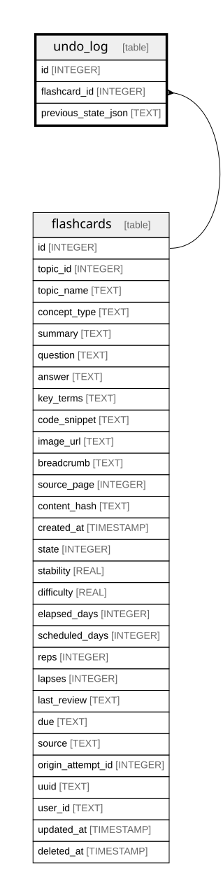

# undo_log

## Description

<details>
<summary><strong>Table Definition</strong></summary>

```sql
CREATE TABLE undo_log (
                id INTEGER PRIMARY KEY CHECK (id = 1),
                flashcard_id INTEGER NOT NULL,
                previous_state_json TEXT NOT NULL,
                FOREIGN KEY (flashcard_id) REFERENCES flashcards (id) ON DELETE CASCADE
            )
```

</details>

## Columns

| Name                | Type    | Default | Nullable | Children | Parents                     | Comment |
| ------------------- | ------- | ------- | -------- | -------- | --------------------------- | ------- |
| id                  | INTEGER |         | true     |          |                             |         |
| flashcard_id        | INTEGER |         | false    |          | [flashcards](flashcards.md) |         |
| previous_state_json | TEXT    |         | false    |          |                             |         |

## Constraints

| Name                  | Type        | Definition                                                                                             |
| --------------------- | ----------- | ------------------------------------------------------------------------------------------------------ |
| id                    | PRIMARY KEY | PRIMARY KEY (id)                                                                                       |
| - (Foreign key ID: 0) | FOREIGN KEY | FOREIGN KEY (flashcard_id) REFERENCES flashcards (id) ON UPDATE NO ACTION ON DELETE CASCADE MATCH NONE |
| -                     | CHECK       | CHECK (id = 1)                                                                                         |

## Relations



---

> Generated by [tbls](https://github.com/k1LoW/tbls)
