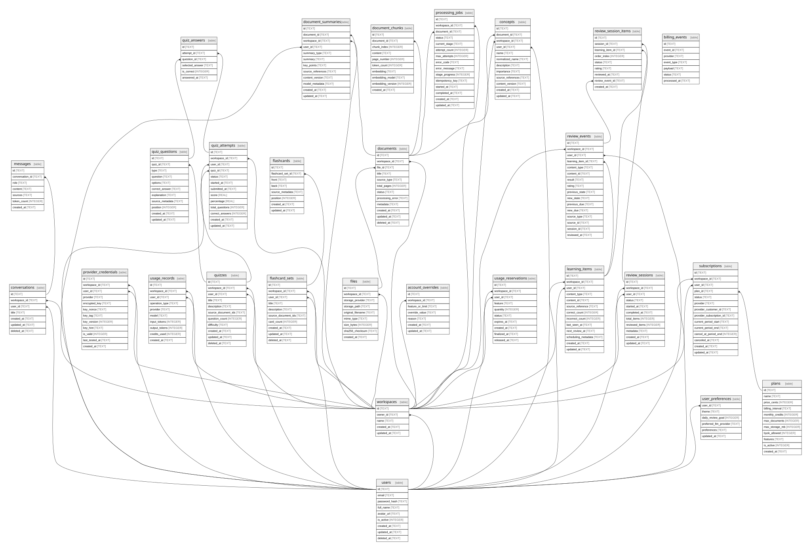

# Recall AI – SaaS DB (recall_saas.db)

## Tables

| Name                                            | Columns | Comment | Type  |
| ----------------------------------------------- | ------- | ------- | ----- |
| [users](users.md)                               | 9       |         | table |
| [workspaces](workspaces.md)                     | 5       |         | table |
| [user_preferences](user_preferences.md)         | 6       |         | table |
| [plans](plans.md)                               | 11      |         | table |
| [files](files.md)                               | 9       |         | table |
| [documents](documents.md)                       | 12      |         | table |
| [document_chunks](document_chunks.md)           | 10      |         | table |
| [processing_jobs](processing_jobs.md)           | 15      |         | table |
| [provider_credentials](provider_credentials.md) | 12      |         | table |
| [conversations](conversations.md)               | 7       |         | table |
| [messages](messages.md)                         | 7       |         | table |
| [usage_records](usage_records.md)               | 10      |         | table |
| [flashcard_sets](flashcard_sets.md)             | 10      |         | table |
| [flashcards](flashcards.md)                     | 8       |         | table |
| [quizzes](quizzes.md)                           | 11      |         | table |
| [quiz_questions](quiz_questions.md)             | 11      |         | table |
| [quiz_attempts](quiz_attempts.md)               | 13      |         | table |
| [quiz_answers](quiz_answers.md)                 | 6       |         | table |
| [learning_items](learning_items.md)             | 13      |         | table |
| [review_events](review_events.md)               | 16      |         | table |
| [review_sessions](review_sessions.md)           | 11      |         | table |
| [review_session_items](review_session_items.md) | 9       |         | table |
| [document_summaries](document_summaries.md)     | 12      |         | table |
| [concepts](concepts.md)                         | 12      |         | table |
| [subscriptions](subscriptions.md)               | 14      |         | table |
| [billing_events](billing_events.md)             | 7       |         | table |
| [usage_reservations](usage_reservations.md)     | 10      |         | table |
| [account_overrides](account_overrides.md)       | 7       |         | table |

## Relations

---

> Generated by [tbls](https://github.com/k1LoW/tbls)
