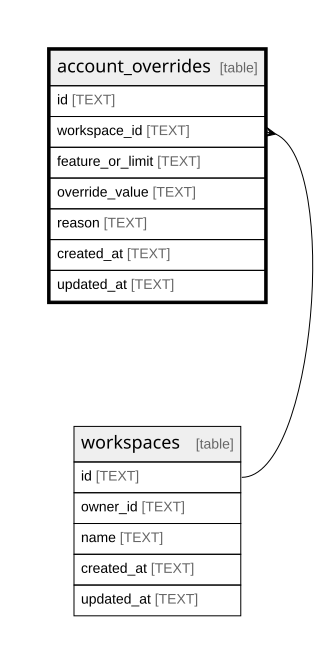

# account_overrides

## Description

<details>
<summary><strong>Table Definition</strong></summary>

```sql
CREATE TABLE account_overrides (
                id TEXT PRIMARY KEY,
                workspace_id TEXT NOT NULL,
                feature_or_limit TEXT NOT NULL,
                override_value TEXT NOT NULL,
                reason TEXT,
                created_at TEXT NOT NULL DEFAULT (strftime('%Y-%m-%dT%H:%M:%SZ', 'now')),
                updated_at TEXT NOT NULL DEFAULT (strftime('%Y-%m-%dT%H:%M:%SZ', 'now')),
                FOREIGN KEY (workspace_id) REFERENCES workspaces(id) ON DELETE CASCADE,
                CONSTRAINT uq_ws_override UNIQUE (workspace_id, feature_or_limit)
            )
```

</details>

## Columns

| Name             | Type | Default                               | Nullable | Children | Parents                     | Comment |
| ---------------- | ---- | ------------------------------------- | -------- | -------- | --------------------------- | ------- |
| id               | TEXT |                                       | true     |          |                             |         |
| workspace_id     | TEXT |                                       | false    |          | [workspaces](workspaces.md) |         |
| feature_or_limit | TEXT |                                       | false    |          |                             |         |
| override_value   | TEXT |                                       | false    |          |                             |         |
| reason           | TEXT |                                       | true     |          |                             |         |
| created_at       | TEXT | strftime('%Y-%m-%dT%H:%M:%SZ', 'now') | false    |          |                             |         |
| updated_at       | TEXT | strftime('%Y-%m-%dT%H:%M:%SZ', 'now') | false    |          |                             |         |

## Constraints

| Name                                 | Type        | Definition                                                                                             |
| ------------------------------------ | ----------- | ------------------------------------------------------------------------------------------------------ |
| id                                   | PRIMARY KEY | PRIMARY KEY (id)                                                                                       |
| - (Foreign key ID: 0)                | FOREIGN KEY | FOREIGN KEY (workspace_id) REFERENCES workspaces (id) ON UPDATE NO ACTION ON DELETE CASCADE MATCH NONE |
| sqlite_autoindex_account_overrides_2 | UNIQUE      | UNIQUE (workspace_id, feature_or_limit)                                                                |
| sqlite_autoindex_account_overrides_1 | PRIMARY KEY | PRIMARY KEY (id)                                                                                       |

## Indexes

| Name                                 | Definition                                                       |
| ------------------------------------ | ---------------------------------------------------------------- |
| idx_overrides_ws                     | CREATE INDEX idx_overrides_ws ON account_overrides(workspace_id) |
| sqlite_autoindex_account_overrides_2 | UNIQUE (workspace_id, feature_or_limit)                          |
| sqlite_autoindex_account_overrides_1 | PRIMARY KEY (id)                                                 |

## Relations



---

> Generated by [tbls](https://github.com/k1LoW/tbls)
