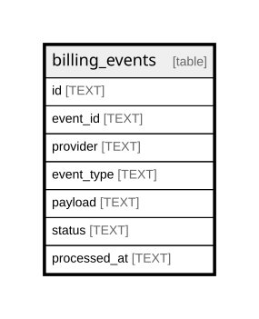

# billing_events

## Description

<details>
<summary><strong>Table Definition</strong></summary>

```sql
CREATE TABLE billing_events (
                id TEXT PRIMARY KEY,
                event_id TEXT NOT NULL UNIQUE,
                provider TEXT NOT NULL DEFAULT 'stripe',
                event_type TEXT NOT NULL,
                payload TEXT NOT NULL,
                status TEXT NOT NULL DEFAULT 'processed',
                processed_at TEXT NOT NULL DEFAULT (strftime('%Y-%m-%dT%H:%M:%SZ', 'now'))
            )
```

</details>

## Columns

| Name         | Type | Default                               | Nullable | Children | Parents | Comment |
| ------------ | ---- | ------------------------------------- | -------- | -------- | ------- | ------- |
| id           | TEXT |                                       | true     |          |         |         |
| event_id     | TEXT |                                       | false    |          |         |         |
| provider     | TEXT | 'stripe'                              | false    |          |         |         |
| event_type   | TEXT |                                       | false    |          |         |         |
| payload      | TEXT |                                       | false    |          |         |         |
| status       | TEXT | 'processed'                           | false    |          |         |         |
| processed_at | TEXT | strftime('%Y-%m-%dT%H:%M:%SZ', 'now') | false    |          |         |         |

## Constraints

| Name                              | Type        | Definition        |
| --------------------------------- | ----------- | ----------------- |
| id                                | PRIMARY KEY | PRIMARY KEY (id)  |
| sqlite_autoindex_billing_events_2 | UNIQUE      | UNIQUE (event_id) |
| sqlite_autoindex_billing_events_1 | PRIMARY KEY | PRIMARY KEY (id)  |

## Indexes

| Name                              | Definition                                                     |
| --------------------------------- | -------------------------------------------------------------- |
| idx_billing_events_id             | CREATE INDEX idx_billing_events_id ON billing_events(event_id) |
| sqlite_autoindex_billing_events_2 | UNIQUE (event_id)                                              |
| sqlite_autoindex_billing_events_1 | PRIMARY KEY (id)                                               |

## Relations



---

> Generated by [tbls](https://github.com/k1LoW/tbls)
