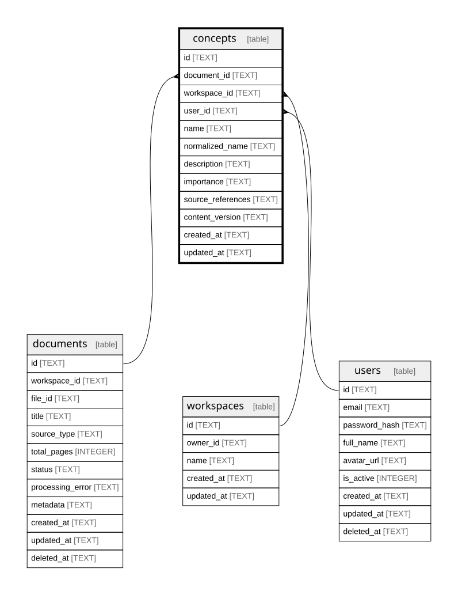

# concepts

## Description

<details>
<summary><strong>Table Definition</strong></summary>

```sql
CREATE TABLE concepts (
                id TEXT PRIMARY KEY,
                document_id TEXT NOT NULL,
                workspace_id TEXT NOT NULL,
                user_id TEXT NOT NULL,
                name TEXT NOT NULL,
                normalized_name TEXT NOT NULL,
                description TEXT NOT NULL,
                importance TEXT NOT NULL DEFAULT 'medium'
                    CHECK (importance IN ('high', 'medium', 'low')),
                source_references TEXT NOT NULL DEFAULT '[]',
                content_version TEXT NOT NULL,
                created_at TEXT NOT NULL DEFAULT (strftime('%Y-%m-%dT%H:%M:%SZ', 'now')),
                updated_at TEXT NOT NULL DEFAULT (strftime('%Y-%m-%dT%H:%M:%SZ', 'now')),
                FOREIGN KEY (document_id) REFERENCES documents(id) ON DELETE CASCADE,
                FOREIGN KEY (workspace_id) REFERENCES workspaces(id) ON DELETE CASCADE,
                FOREIGN KEY (user_id) REFERENCES users(id) ON DELETE CASCADE,
                CONSTRAINT uq_doc_concept UNIQUE (document_id, normalized_name)
            )
```

</details>

## Columns

| Name              | Type | Default                               | Nullable | Children | Parents                     | Comment |
| ----------------- | ---- | ------------------------------------- | -------- | -------- | --------------------------- | ------- |
| id                | TEXT |                                       | true     |          |                             |         |
| document_id       | TEXT |                                       | false    |          | [documents](documents.md)   |         |
| workspace_id      | TEXT |                                       | false    |          | [workspaces](workspaces.md) |         |
| user_id           | TEXT |                                       | false    |          | [users](users.md)           |         |
| name              | TEXT |                                       | false    |          |                             |         |
| normalized_name   | TEXT |                                       | false    |          |                             |         |
| description       | TEXT |                                       | false    |          |                             |         |
| importance        | TEXT | 'medium'                              | false    |          |                             |         |
| source_references | TEXT | '[]'                                  | false    |          |                             |         |
| content_version   | TEXT |                                       | false    |          |                             |         |
| created_at        | TEXT | strftime('%Y-%m-%dT%H:%M:%SZ', 'now') | false    |          |                             |         |
| updated_at        | TEXT | strftime('%Y-%m-%dT%H:%M:%SZ', 'now') | false    |          |                             |         |

## Constraints

| Name                        | Type        | Definition                                                                                             |
| --------------------------- | ----------- | ------------------------------------------------------------------------------------------------------ |
| id                          | PRIMARY KEY | PRIMARY KEY (id)                                                                                       |
| - (Foreign key ID: 0)       | FOREIGN KEY | FOREIGN KEY (user_id) REFERENCES users (id) ON UPDATE NO ACTION ON DELETE CASCADE MATCH NONE           |
| - (Foreign key ID: 1)       | FOREIGN KEY | FOREIGN KEY (workspace_id) REFERENCES workspaces (id) ON UPDATE NO ACTION ON DELETE CASCADE MATCH NONE |
| - (Foreign key ID: 2)       | FOREIGN KEY | FOREIGN KEY (document_id) REFERENCES documents (id) ON UPDATE NO ACTION ON DELETE CASCADE MATCH NONE   |
| sqlite_autoindex_concepts_2 | UNIQUE      | UNIQUE (document_id, normalized_name)                                                                  |
| sqlite_autoindex_concepts_1 | PRIMARY KEY | PRIMARY KEY (id)                                                                                       |
| -                           | CHECK       | CHECK (importance IN ('high', 'medium', 'low'))                                                        |

## Indexes

| Name                        | Definition                                                           |
| --------------------------- | -------------------------------------------------------------------- |
| idx_concepts_ws_user        | CREATE INDEX idx_concepts_ws_user ON concepts(workspace_id, user_id) |
| idx_concepts_doc            | CREATE INDEX idx_concepts_doc ON concepts(document_id)               |
| sqlite_autoindex_concepts_2 | UNIQUE (document_id, normalized_name)                                |
| sqlite_autoindex_concepts_1 | PRIMARY KEY (id)                                                     |

## Relations



---

> Generated by [tbls](https://github.com/k1LoW/tbls)
