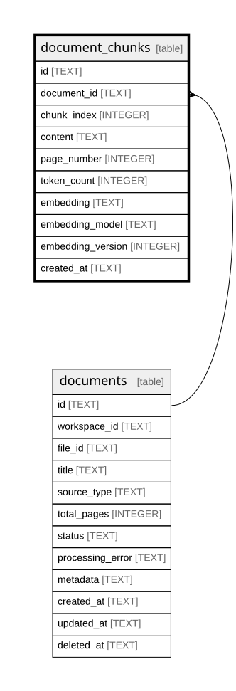

# document_chunks

## Description

<details>
<summary><strong>Table Definition</strong></summary>

```sql
CREATE TABLE document_chunks (
                id TEXT PRIMARY KEY,
                document_id TEXT NOT NULL,
                chunk_index INTEGER NOT NULL CHECK (chunk_index >= 0),
                content TEXT NOT NULL,
                page_number INTEGER,
                token_count INTEGER NOT NULL CHECK (token_count > 0),
                embedding TEXT,
                embedding_model TEXT NOT NULL DEFAULT 'text-embedding-3-small',
                embedding_version INTEGER NOT NULL DEFAULT 1,
                created_at TEXT NOT NULL DEFAULT (strftime('%Y-%m-%dT%H:%M:%SZ', 'now')),
                FOREIGN KEY (document_id) REFERENCES documents(id) ON DELETE CASCADE,
                CONSTRAINT uq_document_chunk UNIQUE (document_id, chunk_index)
            )
```

</details>

## Columns

| Name              | Type    | Default                               | Nullable | Children | Parents                   | Comment |
| ----------------- | ------- | ------------------------------------- | -------- | -------- | ------------------------- | ------- |
| id                | TEXT    |                                       | true     |          |                           |         |
| document_id       | TEXT    |                                       | false    |          | [documents](documents.md) |         |
| chunk_index       | INTEGER |                                       | false    |          |                           |         |
| content           | TEXT    |                                       | false    |          |                           |         |
| page_number       | INTEGER |                                       | true     |          |                           |         |
| token_count       | INTEGER |                                       | false    |          |                           |         |
| embedding         | TEXT    |                                       | true     |          |                           |         |
| embedding_model   | TEXT    | 'text-embedding-3-small'              | false    |          |                           |         |
| embedding_version | INTEGER | 1                                     | false    |          |                           |         |
| created_at        | TEXT    | strftime('%Y-%m-%dT%H:%M:%SZ', 'now') | false    |          |                           |         |

## Constraints

| Name                               | Type        | Definition                                                                                           |
| ---------------------------------- | ----------- | ---------------------------------------------------------------------------------------------------- |
| id                                 | PRIMARY KEY | PRIMARY KEY (id)                                                                                     |
| - (Foreign key ID: 0)              | FOREIGN KEY | FOREIGN KEY (document_id) REFERENCES documents (id) ON UPDATE NO ACTION ON DELETE CASCADE MATCH NONE |
| sqlite_autoindex_document_chunks_2 | UNIQUE      | UNIQUE (document_id, chunk_index)                                                                    |
| sqlite_autoindex_document_chunks_1 | PRIMARY KEY | PRIMARY KEY (id)                                                                                     |
| -                                  | CHECK       | CHECK (chunk_index >= 0)                                                                             |
| -                                  | CHECK       | CHECK (token_count > 0)                                                                              |

## Indexes

| Name                               | Definition                                                                           |
| ---------------------------------- | ------------------------------------------------------------------------------------ |
| idx_chunks_doc_created             | CREATE INDEX idx_chunks_doc_created ON document_chunks(document_id, created_at DESC) |
| idx_chunks_doc                     | CREATE INDEX idx_chunks_doc ON document_chunks(document_id, chunk_index)             |
| sqlite_autoindex_document_chunks_2 | UNIQUE (document_id, chunk_index)                                                    |
| sqlite_autoindex_document_chunks_1 | PRIMARY KEY (id)                                                                     |

## Relations



---

> Generated by [tbls](https://github.com/k1LoW/tbls)
