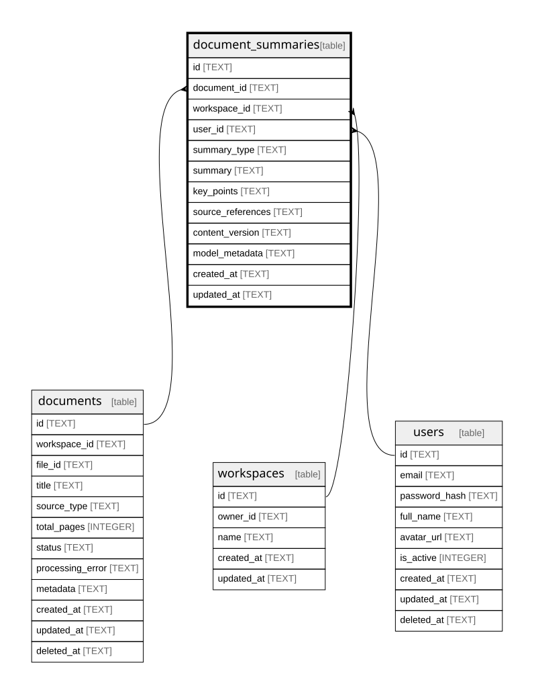

# document_summaries

## Description

<details>
<summary><strong>Table Definition</strong></summary>

```sql
CREATE TABLE document_summaries (
                id TEXT PRIMARY KEY,
                document_id TEXT NOT NULL,
                workspace_id TEXT NOT NULL,
                user_id TEXT NOT NULL,
                summary_type TEXT NOT NULL DEFAULT 'standard'
                    CHECK (summary_type IN ('short', 'standard', 'detailed')),
                summary TEXT NOT NULL,
                key_points TEXT NOT NULL DEFAULT '[]',
                source_references TEXT NOT NULL DEFAULT '[]',
                content_version TEXT NOT NULL,
                model_metadata TEXT NOT NULL DEFAULT '{}',
                created_at TEXT NOT NULL DEFAULT (strftime('%Y-%m-%dT%H:%M:%SZ', 'now')),
                updated_at TEXT NOT NULL DEFAULT (strftime('%Y-%m-%dT%H:%M:%SZ', 'now')),
                FOREIGN KEY (document_id) REFERENCES documents(id) ON DELETE CASCADE,
                FOREIGN KEY (workspace_id) REFERENCES workspaces(id) ON DELETE CASCADE,
                FOREIGN KEY (user_id) REFERENCES users(id) ON DELETE CASCADE,
                CONSTRAINT uq_doc_summary UNIQUE (document_id, summary_type)
            )
```

</details>

## Columns

| Name              | Type | Default                               | Nullable | Children | Parents                     | Comment |
| ----------------- | ---- | ------------------------------------- | -------- | -------- | --------------------------- | ------- |
| id                | TEXT |                                       | true     |          |                             |         |
| document_id       | TEXT |                                       | false    |          | [documents](documents.md)   |         |
| workspace_id      | TEXT |                                       | false    |          | [workspaces](workspaces.md) |         |
| user_id           | TEXT |                                       | false    |          | [users](users.md)           |         |
| summary_type      | TEXT | 'standard'                            | false    |          |                             |         |
| summary           | TEXT |                                       | false    |          |                             |         |
| key_points        | TEXT | '[]'                                  | false    |          |                             |         |
| source_references | TEXT | '[]'                                  | false    |          |                             |         |
| content_version   | TEXT |                                       | false    |          |                             |         |
| model_metadata    | TEXT | '{}'                                  | false    |          |                             |         |
| created_at        | TEXT | strftime('%Y-%m-%dT%H:%M:%SZ', 'now') | false    |          |                             |         |
| updated_at        | TEXT | strftime('%Y-%m-%dT%H:%M:%SZ', 'now') | false    |          |                             |         |

## Constraints

| Name                                  | Type        | Definition                                                                                             |
| ------------------------------------- | ----------- | ------------------------------------------------------------------------------------------------------ |
| id                                    | PRIMARY KEY | PRIMARY KEY (id)                                                                                       |
| - (Foreign key ID: 0)                 | FOREIGN KEY | FOREIGN KEY (user_id) REFERENCES users (id) ON UPDATE NO ACTION ON DELETE CASCADE MATCH NONE           |
| - (Foreign key ID: 1)                 | FOREIGN KEY | FOREIGN KEY (workspace_id) REFERENCES workspaces (id) ON UPDATE NO ACTION ON DELETE CASCADE MATCH NONE |
| - (Foreign key ID: 2)                 | FOREIGN KEY | FOREIGN KEY (document_id) REFERENCES documents (id) ON UPDATE NO ACTION ON DELETE CASCADE MATCH NONE   |
| sqlite_autoindex_document_summaries_2 | UNIQUE      | UNIQUE (document_id, summary_type)                                                                     |
| sqlite_autoindex_document_summaries_1 | PRIMARY KEY | PRIMARY KEY (id)                                                                                       |
| -                                     | CHECK       | CHECK (summary_type IN ('short', 'standard', 'detailed'))                                              |

## Indexes

| Name                                  | Definition                                                                          |
| ------------------------------------- | ----------------------------------------------------------------------------------- |
| idx_doc_summaries_user                | CREATE INDEX idx_doc_summaries_user ON document_summaries(workspace_id, user_id)    |
| idx_doc_summaries_doc                 | CREATE INDEX idx_doc_summaries_doc ON document_summaries(document_id, summary_type) |
| sqlite_autoindex_document_summaries_2 | UNIQUE (document_id, summary_type)                                                  |
| sqlite_autoindex_document_summaries_1 | PRIMARY KEY (id)                                                                    |

## Relations



---

> Generated by [tbls](https://github.com/k1LoW/tbls)
