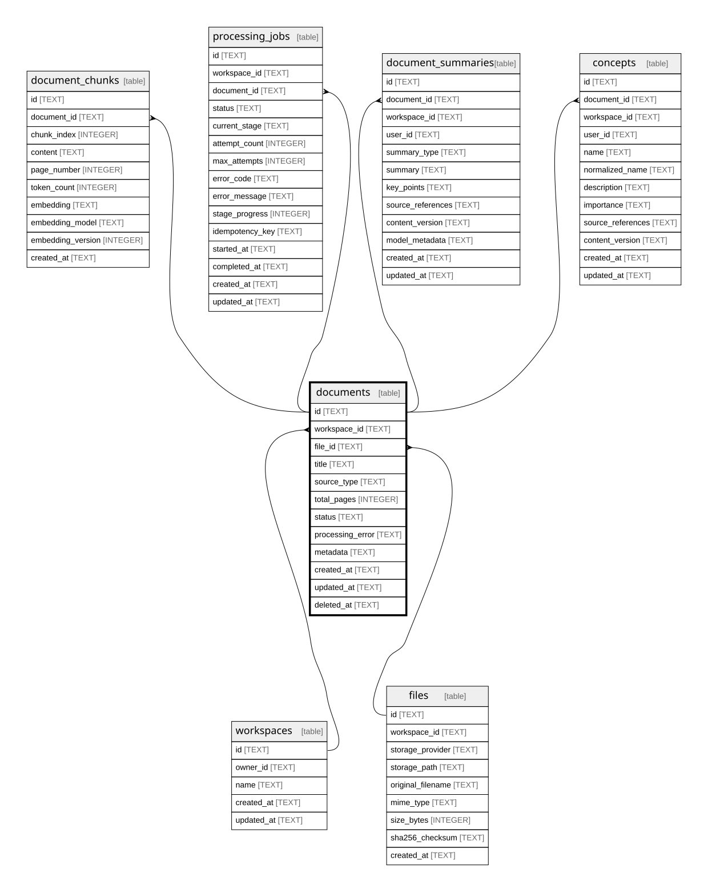

# documents

## Description

<details>
<summary><strong>Table Definition</strong></summary>

```sql
CREATE TABLE documents (
                id TEXT PRIMARY KEY,
                workspace_id TEXT NOT NULL,
                file_id TEXT,
                title TEXT NOT NULL,
                source_type TEXT NOT NULL DEFAULT 'pdf',
                total_pages INTEGER NOT NULL DEFAULT 1 CHECK (total_pages >= 0),
                status TEXT NOT NULL DEFAULT 'ready' CHECK (status IN ('uploading', 'processing', 'ready', 'failed', 'deleted')),
                processing_error TEXT,
                metadata TEXT NOT NULL DEFAULT '{}',
                created_at TEXT NOT NULL DEFAULT (strftime('%Y-%m-%dT%H:%M:%SZ', 'now')),
                updated_at TEXT NOT NULL DEFAULT (strftime('%Y-%m-%dT%H:%M:%SZ', 'now')),
                deleted_at TEXT,
                FOREIGN KEY (workspace_id) REFERENCES workspaces(id) ON DELETE CASCADE,
                FOREIGN KEY (file_id) REFERENCES files(id) ON DELETE SET NULL
            )
```

</details>

## Columns

| Name             | Type    | Default                               | Nullable | Children                                                                                                                                        | Parents                     | Comment |
| ---------------- | ------- | ------------------------------------- | -------- | ----------------------------------------------------------------------------------------------------------------------------------------------- | --------------------------- | ------- |
| id               | TEXT    |                                       | true     | [document_chunks](document_chunks.md) [processing_jobs](processing_jobs.md) [document_summaries](document_summaries.md) [concepts](concepts.md) |                             |         |
| workspace_id     | TEXT    |                                       | false    |                                                                                                                                                 | [workspaces](workspaces.md) |         |
| file_id          | TEXT    |                                       | true     |                                                                                                                                                 | [files](files.md)           |         |
| title            | TEXT    |                                       | false    |                                                                                                                                                 |                             |         |
| source_type      | TEXT    | 'pdf'                                 | false    |                                                                                                                                                 |                             |         |
| total_pages      | INTEGER | 1                                     | false    |                                                                                                                                                 |                             |         |
| status           | TEXT    | 'ready'                               | false    |                                                                                                                                                 |                             |         |
| processing_error | TEXT    |                                       | true     |                                                                                                                                                 |                             |         |
| metadata         | TEXT    | '{}'                                  | false    |                                                                                                                                                 |                             |         |
| created_at       | TEXT    | strftime('%Y-%m-%dT%H:%M:%SZ', 'now') | false    |                                                                                                                                                 |                             |         |
| updated_at       | TEXT    | strftime('%Y-%m-%dT%H:%M:%SZ', 'now') | false    |                                                                                                                                                 |                             |         |
| deleted_at       | TEXT    |                                       | true     |                                                                                                                                                 |                             |         |

## Constraints

| Name                         | Type        | Definition                                                                                             |
| ---------------------------- | ----------- | ------------------------------------------------------------------------------------------------------ |
| id                           | PRIMARY KEY | PRIMARY KEY (id)                                                                                       |
| - (Foreign key ID: 0)        | FOREIGN KEY | FOREIGN KEY (file_id) REFERENCES files (id) ON UPDATE NO ACTION ON DELETE SET NULL MATCH NONE          |
| - (Foreign key ID: 1)        | FOREIGN KEY | FOREIGN KEY (workspace_id) REFERENCES workspaces (id) ON UPDATE NO ACTION ON DELETE CASCADE MATCH NONE |
| sqlite_autoindex_documents_1 | PRIMARY KEY | PRIMARY KEY (id)                                                                                       |
| -                            | CHECK       | CHECK (total_pages >= 0)                                                                               |
| -                            | CHECK       | CHECK (status IN ('uploading', 'processing', 'ready', 'failed', 'deleted'))                            |

## Indexes

| Name                         | Definition                                                                                    |
| ---------------------------- | --------------------------------------------------------------------------------------------- |
| idx_documents_ws_created     | CREATE INDEX idx_documents_ws_created ON documents(workspace_id, deleted_at, created_at DESC) |
| idx_documents_workspace      | CREATE INDEX idx_documents_workspace ON documents(workspace_id, status)                       |
| sqlite_autoindex_documents_1 | PRIMARY KEY (id)                                                                              |

## Relations



---

> Generated by [tbls](https://github.com/k1LoW/tbls)
