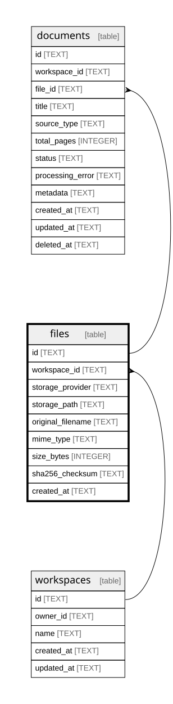

# files

## Description

<details>
<summary><strong>Table Definition</strong></summary>

```sql
CREATE TABLE files (
                id TEXT PRIMARY KEY,
                workspace_id TEXT NOT NULL,
                storage_provider TEXT NOT NULL DEFAULT 'local',
                storage_path TEXT NOT NULL UNIQUE,
                original_filename TEXT NOT NULL,
                mime_type TEXT NOT NULL,
                size_bytes INTEGER NOT NULL,
                sha256_checksum TEXT NOT NULL,
                created_at TEXT NOT NULL DEFAULT (strftime('%Y-%m-%dT%H:%M:%SZ', 'now')),
                FOREIGN KEY (workspace_id) REFERENCES workspaces(id) ON DELETE CASCADE
            )
```

</details>

## Columns

| Name              | Type    | Default                               | Nullable | Children                  | Parents                     | Comment |
| ----------------- | ------- | ------------------------------------- | -------- | ------------------------- | --------------------------- | ------- |
| id                | TEXT    |                                       | true     | [documents](documents.md) |                             |         |
| workspace_id      | TEXT    |                                       | false    |                           | [workspaces](workspaces.md) |         |
| storage_provider  | TEXT    | 'local'                               | false    |                           |                             |         |
| storage_path      | TEXT    |                                       | false    |                           |                             |         |
| original_filename | TEXT    |                                       | false    |                           |                             |         |
| mime_type         | TEXT    |                                       | false    |                           |                             |         |
| size_bytes        | INTEGER |                                       | false    |                           |                             |         |
| sha256_checksum   | TEXT    |                                       | false    |                           |                             |         |
| created_at        | TEXT    | strftime('%Y-%m-%dT%H:%M:%SZ', 'now') | false    |                           |                             |         |

## Constraints

| Name                     | Type        | Definition                                                                                             |
| ------------------------ | ----------- | ------------------------------------------------------------------------------------------------------ |
| id                       | PRIMARY KEY | PRIMARY KEY (id)                                                                                       |
| - (Foreign key ID: 0)    | FOREIGN KEY | FOREIGN KEY (workspace_id) REFERENCES workspaces (id) ON UPDATE NO ACTION ON DELETE CASCADE MATCH NONE |
| sqlite_autoindex_files_2 | UNIQUE      | UNIQUE (storage_path)                                                                                  |
| sqlite_autoindex_files_1 | PRIMARY KEY | PRIMARY KEY (id)                                                                                       |

## Indexes

| Name                     | Definition                                              |
| ------------------------ | ------------------------------------------------------- |
| idx_files_workspace      | CREATE INDEX idx_files_workspace ON files(workspace_id) |
| sqlite_autoindex_files_2 | UNIQUE (storage_path)                                   |
| sqlite_autoindex_files_1 | PRIMARY KEY (id)                                        |

## Relations



---

> Generated by [tbls](https://github.com/k1LoW/tbls)
