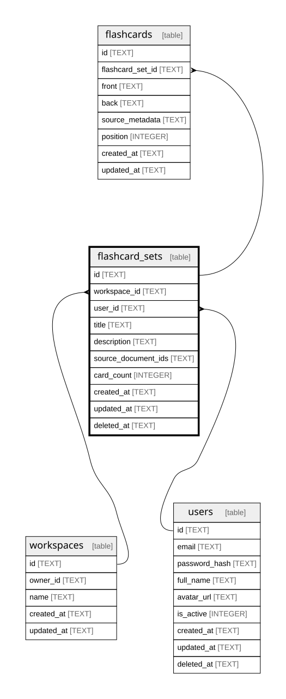

# flashcard_sets

## Description

<details>
<summary><strong>Table Definition</strong></summary>

```sql
CREATE TABLE flashcard_sets (
                id TEXT PRIMARY KEY,
                workspace_id TEXT NOT NULL,
                user_id TEXT NOT NULL,
                title TEXT NOT NULL,
                description TEXT,
                source_document_ids TEXT NOT NULL DEFAULT '[]',
                card_count INTEGER NOT NULL DEFAULT 0,
                created_at TEXT NOT NULL DEFAULT (strftime('%Y-%m-%dT%H:%M:%SZ', 'now')),
                updated_at TEXT NOT NULL DEFAULT (strftime('%Y-%m-%dT%H:%M:%SZ', 'now')),
                deleted_at TEXT,
                FOREIGN KEY (workspace_id) REFERENCES workspaces(id) ON DELETE CASCADE,
                FOREIGN KEY (user_id) REFERENCES users(id) ON DELETE CASCADE
            )
```

</details>

## Columns

| Name                | Type    | Default                               | Nullable | Children                    | Parents                     | Comment |
| ------------------- | ------- | ------------------------------------- | -------- | --------------------------- | --------------------------- | ------- |
| id                  | TEXT    |                                       | true     | [flashcards](flashcards.md) |                             |         |
| workspace_id        | TEXT    |                                       | false    |                             | [workspaces](workspaces.md) |         |
| user_id             | TEXT    |                                       | false    |                             | [users](users.md)           |         |
| title               | TEXT    |                                       | false    |                             |                             |         |
| description         | TEXT    |                                       | true     |                             |                             |         |
| source_document_ids | TEXT    | '[]'                                  | false    |                             |                             |         |
| card_count          | INTEGER | 0                                     | false    |                             |                             |         |
| created_at          | TEXT    | strftime('%Y-%m-%dT%H:%M:%SZ', 'now') | false    |                             |                             |         |
| updated_at          | TEXT    | strftime('%Y-%m-%dT%H:%M:%SZ', 'now') | false    |                             |                             |         |
| deleted_at          | TEXT    |                                       | true     |                             |                             |         |

## Constraints

| Name                              | Type        | Definition                                                                                             |
| --------------------------------- | ----------- | ------------------------------------------------------------------------------------------------------ |
| id                                | PRIMARY KEY | PRIMARY KEY (id)                                                                                       |
| - (Foreign key ID: 0)             | FOREIGN KEY | FOREIGN KEY (user_id) REFERENCES users (id) ON UPDATE NO ACTION ON DELETE CASCADE MATCH NONE           |
| - (Foreign key ID: 1)             | FOREIGN KEY | FOREIGN KEY (workspace_id) REFERENCES workspaces (id) ON UPDATE NO ACTION ON DELETE CASCADE MATCH NONE |
| sqlite_autoindex_flashcard_sets_1 | PRIMARY KEY | PRIMARY KEY (id)                                                                                       |

## Indexes

| Name                              | Definition                                                                                             |
| --------------------------------- | ------------------------------------------------------------------------------------------------------ |
| idx_flashcard_sets_ws_active      | CREATE INDEX idx_flashcard_sets_ws_active ON flashcard_sets(workspace_id, deleted_at, updated_at DESC) |
| idx_flashcard_sets_ws             | CREATE INDEX idx_flashcard_sets_ws ON flashcard_sets(workspace_id, updated_at DESC)                    |
| sqlite_autoindex_flashcard_sets_1 | PRIMARY KEY (id)                                                                                       |

## Relations



---

> Generated by [tbls](https://github.com/k1LoW/tbls)
