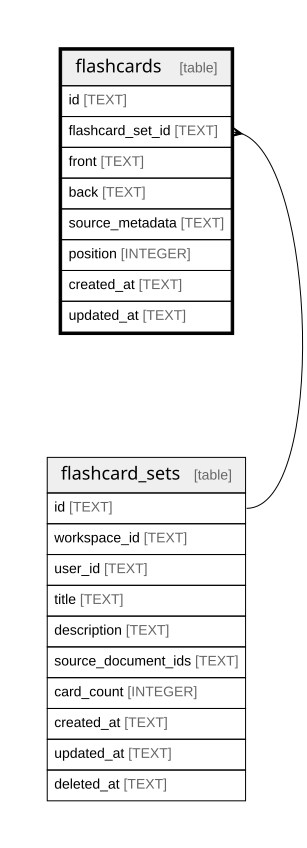

# flashcards

## Description

<details>
<summary><strong>Table Definition</strong></summary>

```sql
CREATE TABLE flashcards (
                id TEXT PRIMARY KEY,
                flashcard_set_id TEXT NOT NULL,
                front TEXT NOT NULL,
                back TEXT NOT NULL,
                source_metadata TEXT NOT NULL DEFAULT '[]',
                position INTEGER NOT NULL DEFAULT 0,
                created_at TEXT NOT NULL DEFAULT (strftime('%Y-%m-%dT%H:%M:%SZ', 'now')),
                updated_at TEXT NOT NULL DEFAULT (strftime('%Y-%m-%dT%H:%M:%SZ', 'now')),
                FOREIGN KEY (flashcard_set_id) REFERENCES flashcard_sets(id) ON DELETE CASCADE
            )
```

</details>

## Columns

| Name             | Type    | Default                               | Nullable | Children | Parents                             | Comment |
| ---------------- | ------- | ------------------------------------- | -------- | -------- | ----------------------------------- | ------- |
| id               | TEXT    |                                       | true     |          |                                     |         |
| flashcard_set_id | TEXT    |                                       | false    |          | [flashcard_sets](flashcard_sets.md) |         |
| front            | TEXT    |                                       | false    |          |                                     |         |
| back             | TEXT    |                                       | false    |          |                                     |         |
| source_metadata  | TEXT    | '[]'                                  | false    |          |                                     |         |
| position         | INTEGER | 0                                     | false    |          |                                     |         |
| created_at       | TEXT    | strftime('%Y-%m-%dT%H:%M:%SZ', 'now') | false    |          |                                     |         |
| updated_at       | TEXT    | strftime('%Y-%m-%dT%H:%M:%SZ', 'now') | false    |          |                                     |         |

## Constraints

| Name                          | Type        | Definition                                                                                                     |
| ----------------------------- | ----------- | -------------------------------------------------------------------------------------------------------------- |
| id                            | PRIMARY KEY | PRIMARY KEY (id)                                                                                               |
| - (Foreign key ID: 0)         | FOREIGN KEY | FOREIGN KEY (flashcard_set_id) REFERENCES flashcard_sets (id) ON UPDATE NO ACTION ON DELETE CASCADE MATCH NONE |
| sqlite_autoindex_flashcards_1 | PRIMARY KEY | PRIMARY KEY (id)                                                                                               |

## Indexes

| Name                          | Definition                                                                    |
| ----------------------------- | ----------------------------------------------------------------------------- |
| idx_flashcards_set            | CREATE INDEX idx_flashcards_set ON flashcards(flashcard_set_id, position ASC) |
| sqlite_autoindex_flashcards_1 | PRIMARY KEY (id)                                                              |

## Relations



---

> Generated by [tbls](https://github.com/k1LoW/tbls)
