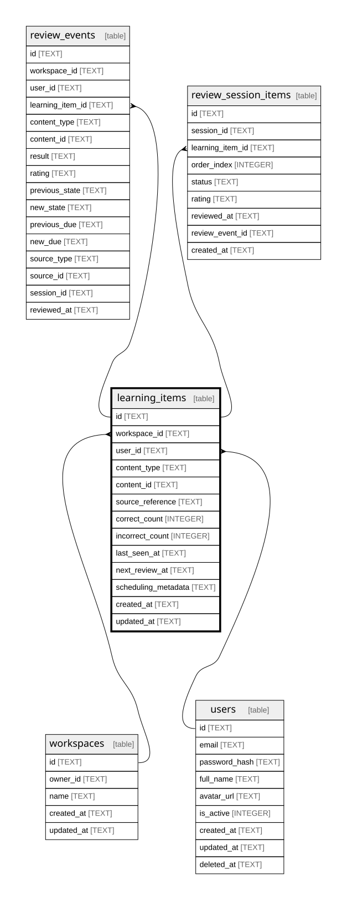

# learning_items

## Description

<details>
<summary><strong>Table Definition</strong></summary>

```sql
CREATE TABLE learning_items (
                id TEXT PRIMARY KEY,
                workspace_id TEXT NOT NULL,
                user_id TEXT NOT NULL,
                content_type TEXT NOT NULL CHECK (content_type IN ('quiz_question', 'flashcard', 'concept')),
                content_id TEXT NOT NULL,
                source_reference TEXT NOT NULL DEFAULT '{}',
                correct_count INTEGER NOT NULL DEFAULT 0,
                incorrect_count INTEGER NOT NULL DEFAULT 0,
                last_seen_at TEXT,
                next_review_at TEXT,
                scheduling_metadata TEXT NOT NULL DEFAULT '{}',
                created_at TEXT NOT NULL DEFAULT (strftime('%Y-%m-%dT%H:%M:%SZ', 'now')),
                updated_at TEXT NOT NULL DEFAULT (strftime('%Y-%m-%dT%H:%M:%SZ', 'now')),
                FOREIGN KEY (workspace_id) REFERENCES workspaces(id) ON DELETE CASCADE,
                FOREIGN KEY (user_id) REFERENCES users(id) ON DELETE CASCADE,
                CONSTRAINT uq_learning_item UNIQUE (workspace_id, user_id, content_type, content_id)
            )
```

</details>

## Columns

| Name                | Type    | Default                               | Nullable | Children                                                                          | Parents                     | Comment |
| ------------------- | ------- | ------------------------------------- | -------- | --------------------------------------------------------------------------------- | --------------------------- | ------- |
| id                  | TEXT    |                                       | true     | [review_events](review_events.md) [review_session_items](review_session_items.md) |                             |         |
| workspace_id        | TEXT    |                                       | false    |                                                                                   | [workspaces](workspaces.md) |         |
| user_id             | TEXT    |                                       | false    |                                                                                   | [users](users.md)           |         |
| content_type        | TEXT    |                                       | false    |                                                                                   |                             |         |
| content_id          | TEXT    |                                       | false    |                                                                                   |                             |         |
| source_reference    | TEXT    | '{}'                                  | false    |                                                                                   |                             |         |
| correct_count       | INTEGER | 0                                     | false    |                                                                                   |                             |         |
| incorrect_count     | INTEGER | 0                                     | false    |                                                                                   |                             |         |
| last_seen_at        | TEXT    |                                       | true     |                                                                                   |                             |         |
| next_review_at      | TEXT    |                                       | true     |                                                                                   |                             |         |
| scheduling_metadata | TEXT    | '{}'                                  | false    |                                                                                   |                             |         |
| created_at          | TEXT    | strftime('%Y-%m-%dT%H:%M:%SZ', 'now') | false    |                                                                                   |                             |         |
| updated_at          | TEXT    | strftime('%Y-%m-%dT%H:%M:%SZ', 'now') | false    |                                                                                   |                             |         |

## Constraints

| Name                              | Type        | Definition                                                                                             |
| --------------------------------- | ----------- | ------------------------------------------------------------------------------------------------------ |
| id                                | PRIMARY KEY | PRIMARY KEY (id)                                                                                       |
| - (Foreign key ID: 0)             | FOREIGN KEY | FOREIGN KEY (user_id) REFERENCES users (id) ON UPDATE NO ACTION ON DELETE CASCADE MATCH NONE           |
| - (Foreign key ID: 1)             | FOREIGN KEY | FOREIGN KEY (workspace_id) REFERENCES workspaces (id) ON UPDATE NO ACTION ON DELETE CASCADE MATCH NONE |
| sqlite_autoindex_learning_items_2 | UNIQUE      | UNIQUE (workspace_id, user_id, content_type, content_id)                                               |
| sqlite_autoindex_learning_items_1 | PRIMARY KEY | PRIMARY KEY (id)                                                                                       |
| -                                 | CHECK       | CHECK (content_type IN ('quiz_question', 'flashcard', 'concept'))                                      |

## Indexes

| Name                               | Definition                                                                                                          |
| ---------------------------------- | ------------------------------------------------------------------------------------------------------------------- |
| idx_learning_items_due_eval        | CREATE INDEX idx_learning_items_due_eval ON learning_items(workspace_id, user_id, content_type, next_review_at ASC) |
| idx_learning_items_ws_user_content | CREATE INDEX idx_learning_items_ws_user_content ON learning_items(workspace_id, user_id, content_type)              |
| idx_learning_items_due             | CREATE INDEX idx_learning_items_due ON learning_items(workspace_id, user_id, next_review_at ASC)                    |
| sqlite_autoindex_learning_items_2  | UNIQUE (workspace_id, user_id, content_type, content_id)                                                            |
| sqlite_autoindex_learning_items_1  | PRIMARY KEY (id)                                                                                                    |

## Relations



---

> Generated by [tbls](https://github.com/k1LoW/tbls)
