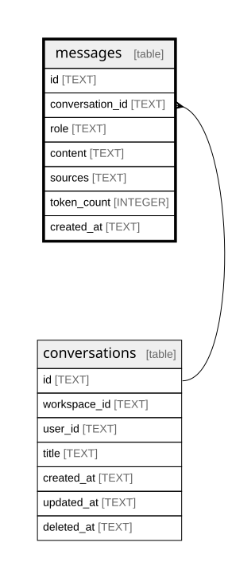

# messages

## Description

<details>
<summary><strong>Table Definition</strong></summary>

```sql
CREATE TABLE messages (
                id TEXT PRIMARY KEY,
                conversation_id TEXT NOT NULL,
                role TEXT NOT NULL CHECK (role IN ('user', 'assistant', 'system')),
                content TEXT NOT NULL,
                sources TEXT NOT NULL DEFAULT '[]',
                token_count INTEGER NOT NULL DEFAULT 0,
                created_at TEXT NOT NULL DEFAULT (strftime('%Y-%m-%dT%H:%M:%SZ', 'now')),
                FOREIGN KEY (conversation_id) REFERENCES conversations(id) ON DELETE CASCADE
            )
```

</details>

## Columns

| Name            | Type    | Default                               | Nullable | Children | Parents                           | Comment |
| --------------- | ------- | ------------------------------------- | -------- | -------- | --------------------------------- | ------- |
| id              | TEXT    |                                       | true     |          |                                   |         |
| conversation_id | TEXT    |                                       | false    |          | [conversations](conversations.md) |         |
| role            | TEXT    |                                       | false    |          |                                   |         |
| content         | TEXT    |                                       | false    |          |                                   |         |
| sources         | TEXT    | '[]'                                  | false    |          |                                   |         |
| token_count     | INTEGER | 0                                     | false    |          |                                   |         |
| created_at      | TEXT    | strftime('%Y-%m-%dT%H:%M:%SZ', 'now') | false    |          |                                   |         |

## Constraints

| Name                        | Type        | Definition                                                                                                   |
| --------------------------- | ----------- | ------------------------------------------------------------------------------------------------------------ |
| id                          | PRIMARY KEY | PRIMARY KEY (id)                                                                                             |
| - (Foreign key ID: 0)       | FOREIGN KEY | FOREIGN KEY (conversation_id) REFERENCES conversations (id) ON UPDATE NO ACTION ON DELETE CASCADE MATCH NONE |
| sqlite_autoindex_messages_1 | PRIMARY KEY | PRIMARY KEY (id)                                                                                             |
| -                           | CHECK       | CHECK (role IN ('user', 'assistant', 'system'))                                                              |

## Indexes

| Name                        | Definition                                                                          |
| --------------------------- | ----------------------------------------------------------------------------------- |
| idx_messages_conversation   | CREATE INDEX idx_messages_conversation ON messages(conversation_id, created_at ASC) |
| sqlite_autoindex_messages_1 | PRIMARY KEY (id)                                                                    |

## Relations



---

> Generated by [tbls](https://github.com/k1LoW/tbls)
