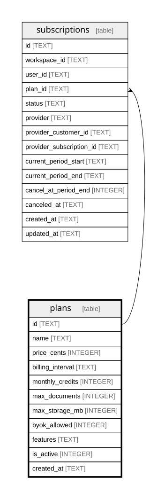

# plans

## Description

<details>
<summary><strong>Table Definition</strong></summary>

```sql
CREATE TABLE plans (
                id TEXT PRIMARY KEY,
                name TEXT NOT NULL,
                price_cents INTEGER NOT NULL DEFAULT 0,
                billing_interval TEXT NOT NULL DEFAULT 'month',
                monthly_credits INTEGER NOT NULL DEFAULT 50,
                max_documents INTEGER NOT NULL DEFAULT 5,
                max_storage_mb INTEGER NOT NULL DEFAULT 50,
                byok_allowed INTEGER NOT NULL DEFAULT 1,
                features TEXT NOT NULL DEFAULT '{}',
                is_active INTEGER NOT NULL DEFAULT 1,
                created_at TEXT NOT NULL DEFAULT (strftime('%Y-%m-%dT%H:%M:%SZ', 'now'))
            )
```

</details>

## Columns

| Name             | Type    | Default                               | Nullable | Children                          | Parents | Comment |
| ---------------- | ------- | ------------------------------------- | -------- | --------------------------------- | ------- | ------- |
| id               | TEXT    |                                       | true     | [subscriptions](subscriptions.md) |         |         |
| name             | TEXT    |                                       | false    |                                   |         |         |
| price_cents      | INTEGER | 0                                     | false    |                                   |         |         |
| billing_interval | TEXT    | 'month'                               | false    |                                   |         |         |
| monthly_credits  | INTEGER | 50                                    | false    |                                   |         |         |
| max_documents    | INTEGER | 5                                     | false    |                                   |         |         |
| max_storage_mb   | INTEGER | 50                                    | false    |                                   |         |         |
| byok_allowed     | INTEGER | 1                                     | false    |                                   |         |         |
| features         | TEXT    | '{}'                                  | false    |                                   |         |         |
| is_active        | INTEGER | 1                                     | false    |                                   |         |         |
| created_at       | TEXT    | strftime('%Y-%m-%dT%H:%M:%SZ', 'now') | false    |                                   |         |         |

## Constraints

| Name                     | Type        | Definition       |
| ------------------------ | ----------- | ---------------- |
| id                       | PRIMARY KEY | PRIMARY KEY (id) |
| sqlite_autoindex_plans_1 | PRIMARY KEY | PRIMARY KEY (id) |

## Indexes

| Name                     | Definition       |
| ------------------------ | ---------------- |
| sqlite_autoindex_plans_1 | PRIMARY KEY (id) |

## Relations



---

> Generated by [tbls](https://github.com/k1LoW/tbls)
