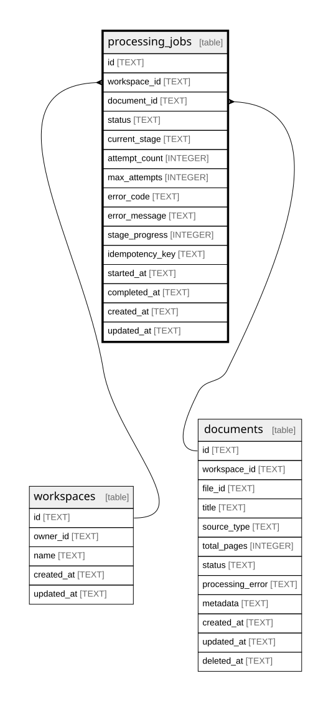

# processing_jobs

## Description

<details>
<summary><strong>Table Definition</strong></summary>

```sql
CREATE TABLE processing_jobs (
                id TEXT PRIMARY KEY,
                workspace_id TEXT NOT NULL,
                document_id TEXT NOT NULL,
                status TEXT NOT NULL DEFAULT 'pending' 
                    CHECK (status IN ('pending', 'running', 'completed', 'failed', 'retrying', 'cancelled')),
                current_stage TEXT NOT NULL DEFAULT 'validation',
                attempt_count INTEGER NOT NULL DEFAULT 0,
                max_attempts INTEGER NOT NULL DEFAULT 3,
                error_code TEXT,
                error_message TEXT,
                stage_progress INTEGER NOT NULL DEFAULT 0 CHECK (stage_progress BETWEEN 0 AND 100),
                idempotency_key TEXT UNIQUE,
                started_at TEXT,
                completed_at TEXT,
                created_at TEXT NOT NULL DEFAULT (strftime('%Y-%m-%dT%H:%M:%SZ', 'now')),
                updated_at TEXT NOT NULL DEFAULT (strftime('%Y-%m-%dT%H:%M:%SZ', 'now')),
                FOREIGN KEY (workspace_id) REFERENCES workspaces(id) ON DELETE CASCADE,
                FOREIGN KEY (document_id) REFERENCES documents(id) ON DELETE CASCADE
            )
```

</details>

## Columns

| Name            | Type    | Default                               | Nullable | Children | Parents                     | Comment |
| --------------- | ------- | ------------------------------------- | -------- | -------- | --------------------------- | ------- |
| id              | TEXT    |                                       | true     |          |                             |         |
| workspace_id    | TEXT    |                                       | false    |          | [workspaces](workspaces.md) |         |
| document_id     | TEXT    |                                       | false    |          | [documents](documents.md)   |         |
| status          | TEXT    | 'pending'                             | false    |          |                             |         |
| current_stage   | TEXT    | 'validation'                          | false    |          |                             |         |
| attempt_count   | INTEGER | 0                                     | false    |          |                             |         |
| max_attempts    | INTEGER | 3                                     | false    |          |                             |         |
| error_code      | TEXT    |                                       | true     |          |                             |         |
| error_message   | TEXT    |                                       | true     |          |                             |         |
| stage_progress  | INTEGER | 0                                     | false    |          |                             |         |
| idempotency_key | TEXT    |                                       | true     |          |                             |         |
| started_at      | TEXT    |                                       | true     |          |                             |         |
| completed_at    | TEXT    |                                       | true     |          |                             |         |
| created_at      | TEXT    | strftime('%Y-%m-%dT%H:%M:%SZ', 'now') | false    |          |                             |         |
| updated_at      | TEXT    | strftime('%Y-%m-%dT%H:%M:%SZ', 'now') | false    |          |                             |         |

## Constraints

| Name                               | Type        | Definition                                                                                             |
| ---------------------------------- | ----------- | ------------------------------------------------------------------------------------------------------ |
| id                                 | PRIMARY KEY | PRIMARY KEY (id)                                                                                       |
| - (Foreign key ID: 0)              | FOREIGN KEY | FOREIGN KEY (document_id) REFERENCES documents (id) ON UPDATE NO ACTION ON DELETE CASCADE MATCH NONE   |
| - (Foreign key ID: 1)              | FOREIGN KEY | FOREIGN KEY (workspace_id) REFERENCES workspaces (id) ON UPDATE NO ACTION ON DELETE CASCADE MATCH NONE |
| sqlite_autoindex_processing_jobs_2 | UNIQUE      | UNIQUE (idempotency_key)                                                                               |
| sqlite_autoindex_processing_jobs_1 | PRIMARY KEY | PRIMARY KEY (id)                                                                                       |
| -                                  | CHECK       | CHECK (status IN ('pending', 'running', 'completed', 'failed', 'retrying', 'cancelled'))               |
| -                                  | CHECK       | CHECK (stage_progress BETWEEN 0 AND 100)                                                               |

## Indexes

| Name                               | Definition                                                                   |
| ---------------------------------- | ---------------------------------------------------------------------------- |
| idx_processing_jobs_doc            | CREATE INDEX idx_processing_jobs_doc ON processing_jobs(document_id, status) |
| sqlite_autoindex_processing_jobs_2 | UNIQUE (idempotency_key)                                                     |
| sqlite_autoindex_processing_jobs_1 | PRIMARY KEY (id)                                                             |

## Relations



---

> Generated by [tbls](https://github.com/k1LoW/tbls)
