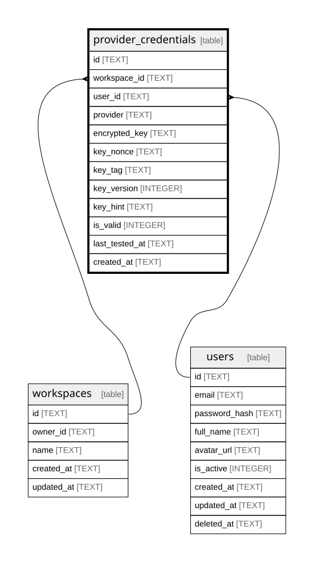

# provider_credentials

## Description

<details>
<summary><strong>Table Definition</strong></summary>

```sql
CREATE TABLE provider_credentials (
                id TEXT PRIMARY KEY,
                workspace_id TEXT NOT NULL,
                user_id TEXT NOT NULL,
                provider TEXT NOT NULL CHECK (provider IN ('gemini', 'openai', 'groq', 'ollama')),
                encrypted_key TEXT NOT NULL,
                key_nonce TEXT NOT NULL,
                key_tag TEXT NOT NULL,
                key_version INTEGER NOT NULL DEFAULT 1,
                key_hint TEXT NOT NULL,
                is_valid INTEGER NOT NULL DEFAULT 1,
                last_tested_at TEXT,
                created_at TEXT NOT NULL DEFAULT (strftime('%Y-%m-%dT%H:%M:%SZ', 'now')),
                FOREIGN KEY (workspace_id) REFERENCES workspaces(id) ON DELETE CASCADE,
                FOREIGN KEY (user_id) REFERENCES users(id) ON DELETE CASCADE,
                CONSTRAINT uq_workspace_provider UNIQUE (workspace_id, provider)
            )
```

</details>

## Columns

| Name           | Type    | Default                               | Nullable | Children | Parents                     | Comment |
| -------------- | ------- | ------------------------------------- | -------- | -------- | --------------------------- | ------- |
| id             | TEXT    |                                       | true     |          |                             |         |
| workspace_id   | TEXT    |                                       | false    |          | [workspaces](workspaces.md) |         |
| user_id        | TEXT    |                                       | false    |          | [users](users.md)           |         |
| provider       | TEXT    |                                       | false    |          |                             |         |
| encrypted_key  | TEXT    |                                       | false    |          |                             |         |
| key_nonce      | TEXT    |                                       | false    |          |                             |         |
| key_tag        | TEXT    |                                       | false    |          |                             |         |
| key_version    | INTEGER | 1                                     | false    |          |                             |         |
| key_hint       | TEXT    |                                       | false    |          |                             |         |
| is_valid       | INTEGER | 1                                     | false    |          |                             |         |
| last_tested_at | TEXT    |                                       | true     |          |                             |         |
| created_at     | TEXT    | strftime('%Y-%m-%dT%H:%M:%SZ', 'now') | false    |          |                             |         |

## Constraints

| Name                                    | Type        | Definition                                                                                             |
| --------------------------------------- | ----------- | ------------------------------------------------------------------------------------------------------ |
| id                                      | PRIMARY KEY | PRIMARY KEY (id)                                                                                       |
| - (Foreign key ID: 0)                   | FOREIGN KEY | FOREIGN KEY (user_id) REFERENCES users (id) ON UPDATE NO ACTION ON DELETE CASCADE MATCH NONE           |
| - (Foreign key ID: 1)                   | FOREIGN KEY | FOREIGN KEY (workspace_id) REFERENCES workspaces (id) ON UPDATE NO ACTION ON DELETE CASCADE MATCH NONE |
| sqlite_autoindex_provider_credentials_2 | UNIQUE      | UNIQUE (workspace_id, provider)                                                                        |
| sqlite_autoindex_provider_credentials_1 | PRIMARY KEY | PRIMARY KEY (id)                                                                                       |
| -                                       | CHECK       | CHECK (provider IN ('gemini', 'openai', 'groq', 'ollama'))                                             |

## Indexes

| Name                                    | Definition                                                                     |
| --------------------------------------- | ------------------------------------------------------------------------------ |
| idx_provider_credentials_ws             | CREATE INDEX idx_provider_credentials_ws ON provider_credentials(workspace_id) |
| sqlite_autoindex_provider_credentials_2 | UNIQUE (workspace_id, provider)                                                |
| sqlite_autoindex_provider_credentials_1 | PRIMARY KEY (id)                                                               |

## Relations



---

> Generated by [tbls](https://github.com/k1LoW/tbls)
