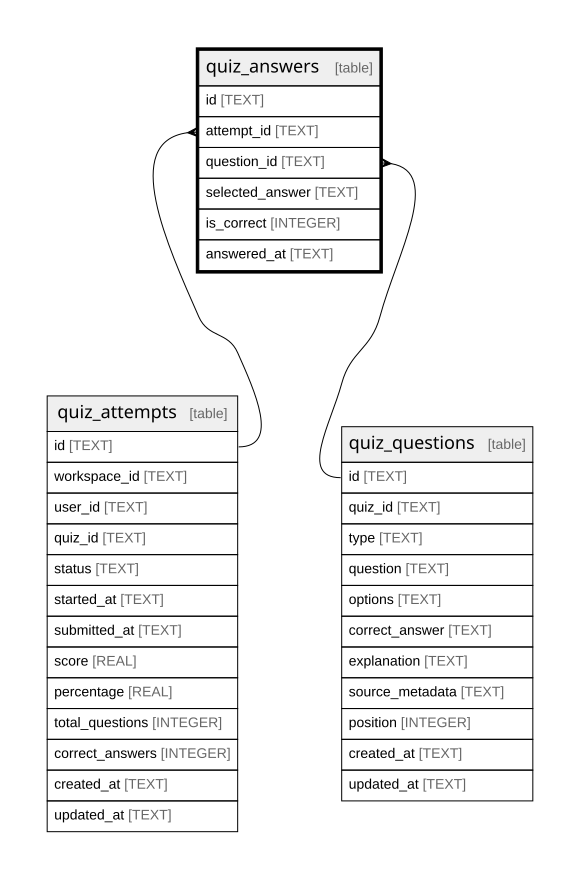

# quiz_answers

## Description

<details>
<summary><strong>Table Definition</strong></summary>

```sql
CREATE TABLE quiz_answers (
                id TEXT PRIMARY KEY,
                attempt_id TEXT NOT NULL,
                question_id TEXT NOT NULL,
                selected_answer TEXT NOT NULL,
                is_correct INTEGER NOT NULL DEFAULT 0 CHECK (is_correct IN (0, 1)),
                answered_at TEXT NOT NULL DEFAULT (strftime('%Y-%m-%dT%H:%M:%SZ', 'now')),
                FOREIGN KEY (attempt_id) REFERENCES quiz_attempts(id) ON DELETE CASCADE,
                FOREIGN KEY (question_id) REFERENCES quiz_questions(id) ON DELETE CASCADE,
                CONSTRAINT uq_attempt_question UNIQUE (attempt_id, question_id)
            )
```

</details>

## Columns

| Name            | Type    | Default                               | Nullable | Children | Parents                             | Comment |
| --------------- | ------- | ------------------------------------- | -------- | -------- | ----------------------------------- | ------- |
| id              | TEXT    |                                       | true     |          |                                     |         |
| attempt_id      | TEXT    |                                       | false    |          | [quiz_attempts](quiz_attempts.md)   |         |
| question_id     | TEXT    |                                       | false    |          | [quiz_questions](quiz_questions.md) |         |
| selected_answer | TEXT    |                                       | false    |          |                                     |         |
| is_correct      | INTEGER | 0                                     | false    |          |                                     |         |
| answered_at     | TEXT    | strftime('%Y-%m-%dT%H:%M:%SZ', 'now') | false    |          |                                     |         |

## Constraints

| Name                            | Type        | Definition                                                                                                |
| ------------------------------- | ----------- | --------------------------------------------------------------------------------------------------------- |
| id                              | PRIMARY KEY | PRIMARY KEY (id)                                                                                          |
| - (Foreign key ID: 0)           | FOREIGN KEY | FOREIGN KEY (question_id) REFERENCES quiz_questions (id) ON UPDATE NO ACTION ON DELETE CASCADE MATCH NONE |
| - (Foreign key ID: 1)           | FOREIGN KEY | FOREIGN KEY (attempt_id) REFERENCES quiz_attempts (id) ON UPDATE NO ACTION ON DELETE CASCADE MATCH NONE   |
| sqlite_autoindex_quiz_answers_2 | UNIQUE      | UNIQUE (attempt_id, question_id)                                                                          |
| sqlite_autoindex_quiz_answers_1 | PRIMARY KEY | PRIMARY KEY (id)                                                                                          |
| -                               | CHECK       | CHECK (is_correct IN (0, 1))                                                                              |

## Indexes

| Name                            | Definition                                                        |
| ------------------------------- | ----------------------------------------------------------------- |
| idx_quiz_answers_attempt        | CREATE INDEX idx_quiz_answers_attempt ON quiz_answers(attempt_id) |
| sqlite_autoindex_quiz_answers_2 | UNIQUE (attempt_id, question_id)                                  |
| sqlite_autoindex_quiz_answers_1 | PRIMARY KEY (id)                                                  |

## Relations



---

> Generated by [tbls](https://github.com/k1LoW/tbls)
