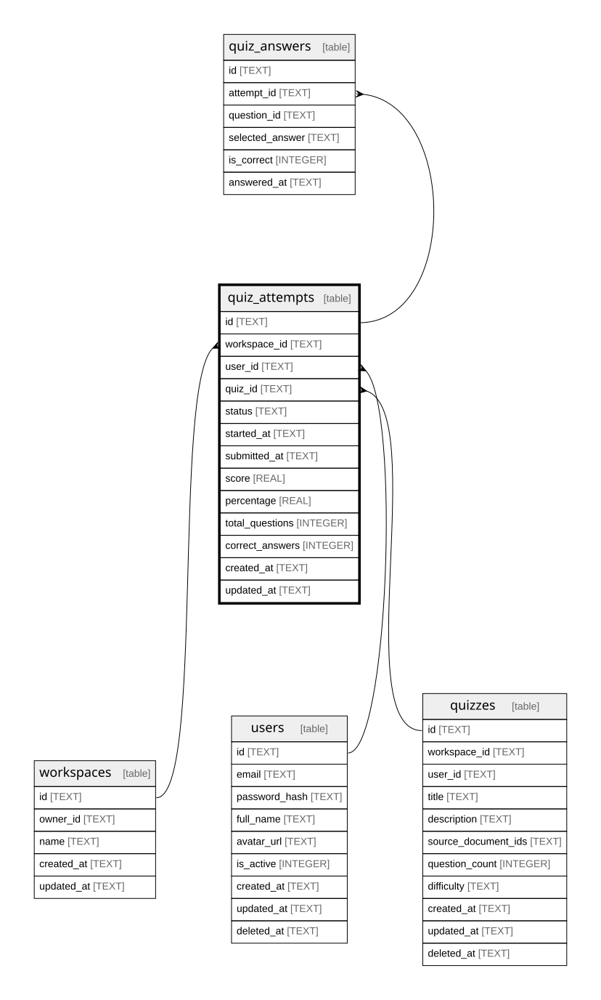

# quiz_attempts

## Description

<details>
<summary><strong>Table Definition</strong></summary>

```sql
CREATE TABLE quiz_attempts (
                id TEXT PRIMARY KEY,
                workspace_id TEXT NOT NULL,
                user_id TEXT NOT NULL,
                quiz_id TEXT NOT NULL,
                status TEXT NOT NULL DEFAULT 'in_progress' CHECK (status IN ('in_progress', 'submitted', 'abandoned')),
                started_at TEXT NOT NULL DEFAULT (strftime('%Y-%m-%dT%H:%M:%SZ', 'now')),
                submitted_at TEXT,
                score REAL NOT NULL DEFAULT 0.0,
                percentage REAL NOT NULL DEFAULT 0.0,
                total_questions INTEGER NOT NULL DEFAULT 0,
                correct_answers INTEGER NOT NULL DEFAULT 0,
                created_at TEXT NOT NULL DEFAULT (strftime('%Y-%m-%dT%H:%M:%SZ', 'now')),
                updated_at TEXT NOT NULL DEFAULT (strftime('%Y-%m-%dT%H:%M:%SZ', 'now')),
                FOREIGN KEY (workspace_id) REFERENCES workspaces(id) ON DELETE CASCADE,
                FOREIGN KEY (user_id) REFERENCES users(id) ON DELETE CASCADE,
                FOREIGN KEY (quiz_id) REFERENCES quizzes(id) ON DELETE CASCADE
            )
```

</details>

## Columns

| Name            | Type    | Default                               | Nullable | Children                        | Parents                     | Comment |
| --------------- | ------- | ------------------------------------- | -------- | ------------------------------- | --------------------------- | ------- |
| id              | TEXT    |                                       | true     | [quiz_answers](quiz_answers.md) |                             |         |
| workspace_id    | TEXT    |                                       | false    |                                 | [workspaces](workspaces.md) |         |
| user_id         | TEXT    |                                       | false    |                                 | [users](users.md)           |         |
| quiz_id         | TEXT    |                                       | false    |                                 | [quizzes](quizzes.md)       |         |
| status          | TEXT    | 'in_progress'                         | false    |                                 |                             |         |
| started_at      | TEXT    | strftime('%Y-%m-%dT%H:%M:%SZ', 'now') | false    |                                 |                             |         |
| submitted_at    | TEXT    |                                       | true     |                                 |                             |         |
| score           | REAL    | 0.0                                   | false    |                                 |                             |         |
| percentage      | REAL    | 0.0                                   | false    |                                 |                             |         |
| total_questions | INTEGER | 0                                     | false    |                                 |                             |         |
| correct_answers | INTEGER | 0                                     | false    |                                 |                             |         |
| created_at      | TEXT    | strftime('%Y-%m-%dT%H:%M:%SZ', 'now') | false    |                                 |                             |         |
| updated_at      | TEXT    | strftime('%Y-%m-%dT%H:%M:%SZ', 'now') | false    |                                 |                             |         |

## Constraints

| Name                             | Type        | Definition                                                                                             |
| -------------------------------- | ----------- | ------------------------------------------------------------------------------------------------------ |
| id                               | PRIMARY KEY | PRIMARY KEY (id)                                                                                       |
| - (Foreign key ID: 0)            | FOREIGN KEY | FOREIGN KEY (quiz_id) REFERENCES quizzes (id) ON UPDATE NO ACTION ON DELETE CASCADE MATCH NONE         |
| - (Foreign key ID: 1)            | FOREIGN KEY | FOREIGN KEY (user_id) REFERENCES users (id) ON UPDATE NO ACTION ON DELETE CASCADE MATCH NONE           |
| - (Foreign key ID: 2)            | FOREIGN KEY | FOREIGN KEY (workspace_id) REFERENCES workspaces (id) ON UPDATE NO ACTION ON DELETE CASCADE MATCH NONE |
| sqlite_autoindex_quiz_attempts_1 | PRIMARY KEY | PRIMARY KEY (id)                                                                                       |
| -                                | CHECK       | CHECK (status IN ('in_progress', 'submitted', 'abandoned'))                                            |

## Indexes

| Name                             | Definition                                                                                                  |
| -------------------------------- | ----------------------------------------------------------------------------------------------------------- |
| idx_quiz_attempts_submitted      | CREATE INDEX idx_quiz_attempts_submitted ON quiz_attempts(workspace_id, user_id, status, submitted_at DESC) |
| idx_quiz_attempts_quiz           | CREATE INDEX idx_quiz_attempts_quiz ON quiz_attempts(quiz_id)                                               |
| idx_quiz_attempts_ws_user        | CREATE INDEX idx_quiz_attempts_ws_user ON quiz_attempts(workspace_id, user_id, updated_at DESC)             |
| sqlite_autoindex_quiz_attempts_1 | PRIMARY KEY (id)                                                                                            |

## Relations



---

> Generated by [tbls](https://github.com/k1LoW/tbls)
