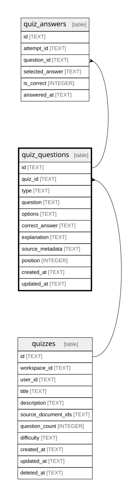

# quiz_questions

## Description

<details>
<summary><strong>Table Definition</strong></summary>

```sql
CREATE TABLE quiz_questions (
                id TEXT PRIMARY KEY,
                quiz_id TEXT NOT NULL,
                type TEXT NOT NULL CHECK (type IN ('multiple_choice', 'true_false')),
                question TEXT NOT NULL,
                options TEXT NOT NULL DEFAULT '[]',
                correct_answer TEXT NOT NULL,
                explanation TEXT NOT NULL,
                source_metadata TEXT NOT NULL DEFAULT '[]',
                position INTEGER NOT NULL DEFAULT 0,
                created_at TEXT NOT NULL DEFAULT (strftime('%Y-%m-%dT%H:%M:%SZ', 'now')),
                updated_at TEXT NOT NULL DEFAULT (strftime('%Y-%m-%dT%H:%M:%SZ', 'now')),
                FOREIGN KEY (quiz_id) REFERENCES quizzes(id) ON DELETE CASCADE
            )
```

</details>

## Columns

| Name            | Type    | Default                               | Nullable | Children                        | Parents               | Comment |
| --------------- | ------- | ------------------------------------- | -------- | ------------------------------- | --------------------- | ------- |
| id              | TEXT    |                                       | true     | [quiz_answers](quiz_answers.md) |                       |         |
| quiz_id         | TEXT    |                                       | false    |                                 | [quizzes](quizzes.md) |         |
| type            | TEXT    |                                       | false    |                                 |                       |         |
| question        | TEXT    |                                       | false    |                                 |                       |         |
| options         | TEXT    | '[]'                                  | false    |                                 |                       |         |
| correct_answer  | TEXT    |                                       | false    |                                 |                       |         |
| explanation     | TEXT    |                                       | false    |                                 |                       |         |
| source_metadata | TEXT    | '[]'                                  | false    |                                 |                       |         |
| position        | INTEGER | 0                                     | false    |                                 |                       |         |
| created_at      | TEXT    | strftime('%Y-%m-%dT%H:%M:%SZ', 'now') | false    |                                 |                       |         |
| updated_at      | TEXT    | strftime('%Y-%m-%dT%H:%M:%SZ', 'now') | false    |                                 |                       |         |

## Constraints

| Name                              | Type        | Definition                                                                                     |
| --------------------------------- | ----------- | ---------------------------------------------------------------------------------------------- |
| id                                | PRIMARY KEY | PRIMARY KEY (id)                                                                               |
| - (Foreign key ID: 0)             | FOREIGN KEY | FOREIGN KEY (quiz_id) REFERENCES quizzes (id) ON UPDATE NO ACTION ON DELETE CASCADE MATCH NONE |
| sqlite_autoindex_quiz_questions_1 | PRIMARY KEY | PRIMARY KEY (id)                                                                               |
| -                                 | CHECK       | CHECK (type IN ('multiple_choice', 'true_false'))                                              |

## Indexes

| Name                              | Definition                                                                    |
| --------------------------------- | ----------------------------------------------------------------------------- |
| idx_quiz_questions_quiz           | CREATE INDEX idx_quiz_questions_quiz ON quiz_questions(quiz_id, position ASC) |
| sqlite_autoindex_quiz_questions_1 | PRIMARY KEY (id)                                                              |

## Relations



---

> Generated by [tbls](https://github.com/k1LoW/tbls)
