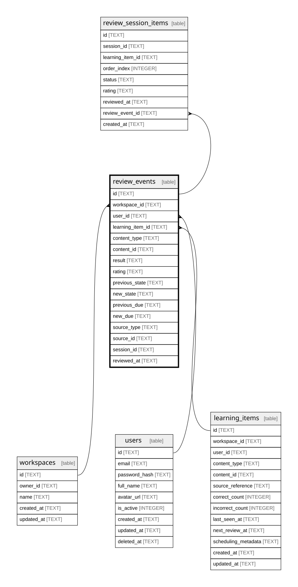

# review_events

## Description

<details>
<summary><strong>Table Definition</strong></summary>

```sql
CREATE TABLE review_events (
                id TEXT PRIMARY KEY,
                workspace_id TEXT NOT NULL,
                user_id TEXT NOT NULL,
                learning_item_id TEXT,
                content_type TEXT NOT NULL,
                content_id TEXT NOT NULL,
                result TEXT NOT NULL,
                rating TEXT NOT NULL DEFAULT 'good' CHECK (rating IN ('again', 'hard', 'good', 'easy', 'correct', 'incorrect')),
                previous_state TEXT NOT NULL DEFAULT '{}',
                new_state TEXT NOT NULL DEFAULT '{}',
                previous_due TEXT,
                new_due TEXT,
                source_type TEXT NOT NULL DEFAULT 'quiz_attempt',
                source_id TEXT,
                session_id TEXT,
                reviewed_at TEXT NOT NULL DEFAULT (strftime('%Y-%m-%dT%H:%M:%SZ', 'now')),
                FOREIGN KEY (workspace_id) REFERENCES workspaces(id) ON DELETE CASCADE,
                FOREIGN KEY (user_id) REFERENCES users(id) ON DELETE CASCADE,
                FOREIGN KEY (learning_item_id) REFERENCES learning_items(id) ON DELETE SET NULL
            )
```

</details>

## Columns

| Name             | Type | Default                               | Nullable | Children                                        | Parents                             | Comment |
| ---------------- | ---- | ------------------------------------- | -------- | ----------------------------------------------- | ----------------------------------- | ------- |
| id               | TEXT |                                       | true     | [review_session_items](review_session_items.md) |                                     |         |
| workspace_id     | TEXT |                                       | false    |                                                 | [workspaces](workspaces.md)         |         |
| user_id          | TEXT |                                       | false    |                                                 | [users](users.md)                   |         |
| learning_item_id | TEXT |                                       | true     |                                                 | [learning_items](learning_items.md) |         |
| content_type     | TEXT |                                       | false    |                                                 |                                     |         |
| content_id       | TEXT |                                       | false    |                                                 |                                     |         |
| result           | TEXT |                                       | false    |                                                 |                                     |         |
| rating           | TEXT | 'good'                                | false    |                                                 |                                     |         |
| previous_state   | TEXT | '{}'                                  | false    |                                                 |                                     |         |
| new_state        | TEXT | '{}'                                  | false    |                                                 |                                     |         |
| previous_due     | TEXT |                                       | true     |                                                 |                                     |         |
| new_due          | TEXT |                                       | true     |                                                 |                                     |         |
| source_type      | TEXT | 'quiz_attempt'                        | false    |                                                 |                                     |         |
| source_id        | TEXT |                                       | true     |                                                 |                                     |         |
| session_id       | TEXT |                                       | true     |                                                 |                                     |         |
| reviewed_at      | TEXT | strftime('%Y-%m-%dT%H:%M:%SZ', 'now') | false    |                                                 |                                     |         |

## Constraints

| Name                             | Type        | Definition                                                                                                      |
| -------------------------------- | ----------- | --------------------------------------------------------------------------------------------------------------- |
| id                               | PRIMARY KEY | PRIMARY KEY (id)                                                                                                |
| - (Foreign key ID: 0)            | FOREIGN KEY | FOREIGN KEY (learning_item_id) REFERENCES learning_items (id) ON UPDATE NO ACTION ON DELETE SET NULL MATCH NONE |
| - (Foreign key ID: 1)            | FOREIGN KEY | FOREIGN KEY (user_id) REFERENCES users (id) ON UPDATE NO ACTION ON DELETE CASCADE MATCH NONE                    |
| - (Foreign key ID: 2)            | FOREIGN KEY | FOREIGN KEY (workspace_id) REFERENCES workspaces (id) ON UPDATE NO ACTION ON DELETE CASCADE MATCH NONE          |
| sqlite_autoindex_review_events_1 | PRIMARY KEY | PRIMARY KEY (id)                                                                                                |
| -                                | CHECK       | CHECK (rating IN ('again', 'hard', 'good', 'easy', 'correct', 'incorrect'))                                     |

## Indexes

| Name                             | Definition                                                                                    |
| -------------------------------- | --------------------------------------------------------------------------------------------- |
| idx_review_events_item           | CREATE INDEX idx_review_events_item ON review_events(learning_item_id)                        |
| idx_review_events_user           | CREATE INDEX idx_review_events_user ON review_events(workspace_id, user_id, reviewed_at DESC) |
| sqlite_autoindex_review_events_1 | PRIMARY KEY (id)                                                                              |

## Relations



---

> Generated by [tbls](https://github.com/k1LoW/tbls)
