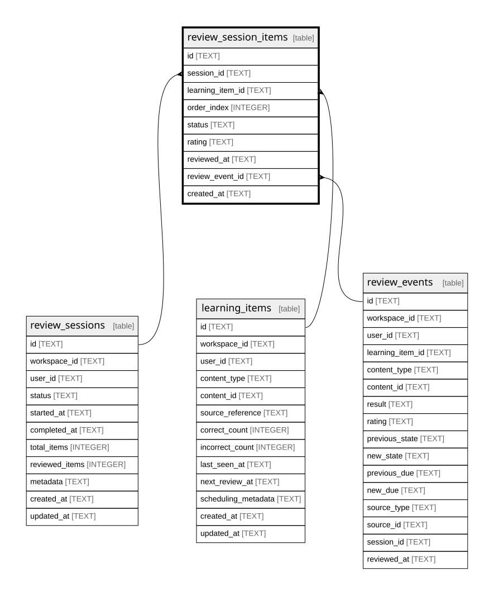

# review_session_items

## Description

<details>
<summary><strong>Table Definition</strong></summary>

```sql
CREATE TABLE review_session_items (
                id TEXT PRIMARY KEY,
                session_id TEXT NOT NULL,
                learning_item_id TEXT NOT NULL,
                order_index INTEGER NOT NULL DEFAULT 0,
                status TEXT NOT NULL DEFAULT 'pending' CHECK (status IN ('pending', 'revealed', 'completed', 'skipped')),
                rating TEXT CHECK (rating IN ('again', 'hard', 'good', 'easy')),
                reviewed_at TEXT,
                review_event_id TEXT,
                created_at TEXT NOT NULL DEFAULT (strftime('%Y-%m-%dT%H:%M:%SZ', 'now')),
                FOREIGN KEY (session_id) REFERENCES review_sessions(id) ON DELETE CASCADE,
                FOREIGN KEY (learning_item_id) REFERENCES learning_items(id) ON DELETE CASCADE,
                FOREIGN KEY (review_event_id) REFERENCES review_events(id) ON DELETE SET NULL,
                CONSTRAINT uq_session_item UNIQUE (session_id, learning_item_id)
            )
```

</details>

## Columns

| Name             | Type    | Default                               | Nullable | Children | Parents                               | Comment |
| ---------------- | ------- | ------------------------------------- | -------- | -------- | ------------------------------------- | ------- |
| id               | TEXT    |                                       | true     |          |                                       |         |
| session_id       | TEXT    |                                       | false    |          | [review_sessions](review_sessions.md) |         |
| learning_item_id | TEXT    |                                       | false    |          | [learning_items](learning_items.md)   |         |
| order_index      | INTEGER | 0                                     | false    |          |                                       |         |
| status           | TEXT    | 'pending'                             | false    |          |                                       |         |
| rating           | TEXT    |                                       | true     |          |                                       |         |
| reviewed_at      | TEXT    |                                       | true     |          |                                       |         |
| review_event_id  | TEXT    |                                       | true     |          | [review_events](review_events.md)     |         |
| created_at       | TEXT    | strftime('%Y-%m-%dT%H:%M:%SZ', 'now') | false    |          |                                       |         |

## Constraints

| Name                                    | Type        | Definition                                                                                                     |
| --------------------------------------- | ----------- | -------------------------------------------------------------------------------------------------------------- |
| id                                      | PRIMARY KEY | PRIMARY KEY (id)                                                                                               |
| - (Foreign key ID: 0)                   | FOREIGN KEY | FOREIGN KEY (review_event_id) REFERENCES review_events (id) ON UPDATE NO ACTION ON DELETE SET NULL MATCH NONE  |
| - (Foreign key ID: 1)                   | FOREIGN KEY | FOREIGN KEY (learning_item_id) REFERENCES learning_items (id) ON UPDATE NO ACTION ON DELETE CASCADE MATCH NONE |
| - (Foreign key ID: 2)                   | FOREIGN KEY | FOREIGN KEY (session_id) REFERENCES review_sessions (id) ON UPDATE NO ACTION ON DELETE CASCADE MATCH NONE      |
| sqlite_autoindex_review_session_items_2 | UNIQUE      | UNIQUE (session_id, learning_item_id)                                                                          |
| sqlite_autoindex_review_session_items_1 | PRIMARY KEY | PRIMARY KEY (id)                                                                                               |
| -                                       | CHECK       | CHECK (status IN ('pending', 'revealed', 'completed', 'skipped'))                                              |
| -                                       | CHECK       | CHECK (rating IN ('again', 'hard', 'good', 'easy'))                                                            |

## Indexes

| Name                                    | Definition                                                                                |
| --------------------------------------- | ----------------------------------------------------------------------------------------- |
| idx_session_items_status                | CREATE INDEX idx_session_items_status ON review_session_items(session_id, status)         |
| idx_session_items_order                 | CREATE INDEX idx_session_items_order ON review_session_items(session_id, order_index ASC) |
| sqlite_autoindex_review_session_items_2 | UNIQUE (session_id, learning_item_id)                                                     |
| sqlite_autoindex_review_session_items_1 | PRIMARY KEY (id)                                                                          |

## Relations



---

> Generated by [tbls](https://github.com/k1LoW/tbls)
