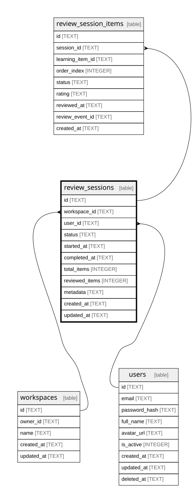

# review_sessions

## Description

<details>
<summary><strong>Table Definition</strong></summary>

```sql
CREATE TABLE review_sessions (
                id TEXT PRIMARY KEY,
                workspace_id TEXT NOT NULL,
                user_id TEXT NOT NULL,
                status TEXT NOT NULL DEFAULT 'active' CHECK (status IN ('active', 'completed', 'abandoned')),
                started_at TEXT NOT NULL DEFAULT (strftime('%Y-%m-%dT%H:%M:%SZ', 'now')),
                completed_at TEXT,
                total_items INTEGER NOT NULL DEFAULT 0,
                reviewed_items INTEGER NOT NULL DEFAULT 0,
                metadata TEXT NOT NULL DEFAULT '{}',
                created_at TEXT NOT NULL DEFAULT (strftime('%Y-%m-%dT%H:%M:%SZ', 'now')),
                updated_at TEXT NOT NULL DEFAULT (strftime('%Y-%m-%dT%H:%M:%SZ', 'now')),
                FOREIGN KEY (workspace_id) REFERENCES workspaces(id) ON DELETE CASCADE,
                FOREIGN KEY (user_id) REFERENCES users(id) ON DELETE CASCADE
            )
```

</details>

## Columns

| Name           | Type    | Default                               | Nullable | Children                                        | Parents                     | Comment |
| -------------- | ------- | ------------------------------------- | -------- | ----------------------------------------------- | --------------------------- | ------- |
| id             | TEXT    |                                       | true     | [review_session_items](review_session_items.md) |                             |         |
| workspace_id   | TEXT    |                                       | false    |                                                 | [workspaces](workspaces.md) |         |
| user_id        | TEXT    |                                       | false    |                                                 | [users](users.md)           |         |
| status         | TEXT    | 'active'                              | false    |                                                 |                             |         |
| started_at     | TEXT    | strftime('%Y-%m-%dT%H:%M:%SZ', 'now') | false    |                                                 |                             |         |
| completed_at   | TEXT    |                                       | true     |                                                 |                             |         |
| total_items    | INTEGER | 0                                     | false    |                                                 |                             |         |
| reviewed_items | INTEGER | 0                                     | false    |                                                 |                             |         |
| metadata       | TEXT    | '{}'                                  | false    |                                                 |                             |         |
| created_at     | TEXT    | strftime('%Y-%m-%dT%H:%M:%SZ', 'now') | false    |                                                 |                             |         |
| updated_at     | TEXT    | strftime('%Y-%m-%dT%H:%M:%SZ', 'now') | false    |                                                 |                             |         |

## Constraints

| Name                               | Type        | Definition                                                                                             |
| ---------------------------------- | ----------- | ------------------------------------------------------------------------------------------------------ |
| id                                 | PRIMARY KEY | PRIMARY KEY (id)                                                                                       |
| - (Foreign key ID: 0)              | FOREIGN KEY | FOREIGN KEY (user_id) REFERENCES users (id) ON UPDATE NO ACTION ON DELETE CASCADE MATCH NONE           |
| - (Foreign key ID: 1)              | FOREIGN KEY | FOREIGN KEY (workspace_id) REFERENCES workspaces (id) ON UPDATE NO ACTION ON DELETE CASCADE MATCH NONE |
| sqlite_autoindex_review_sessions_1 | PRIMARY KEY | PRIMARY KEY (id)                                                                                       |
| -                                  | CHECK       | CHECK (status IN ('active', 'completed', 'abandoned'))                                                 |

## Indexes

| Name                               | Definition                                                                                          |
| ---------------------------------- | --------------------------------------------------------------------------------------------------- |
| idx_review_sessions_started        | CREATE INDEX idx_review_sessions_started ON review_sessions(workspace_id, user_id, started_at DESC) |
| idx_review_sessions_user           | CREATE INDEX idx_review_sessions_user ON review_sessions(workspace_id, user_id, status)             |
| sqlite_autoindex_review_sessions_1 | PRIMARY KEY (id)                                                                                    |

## Relations



---

> Generated by [tbls](https://github.com/k1LoW/tbls)
