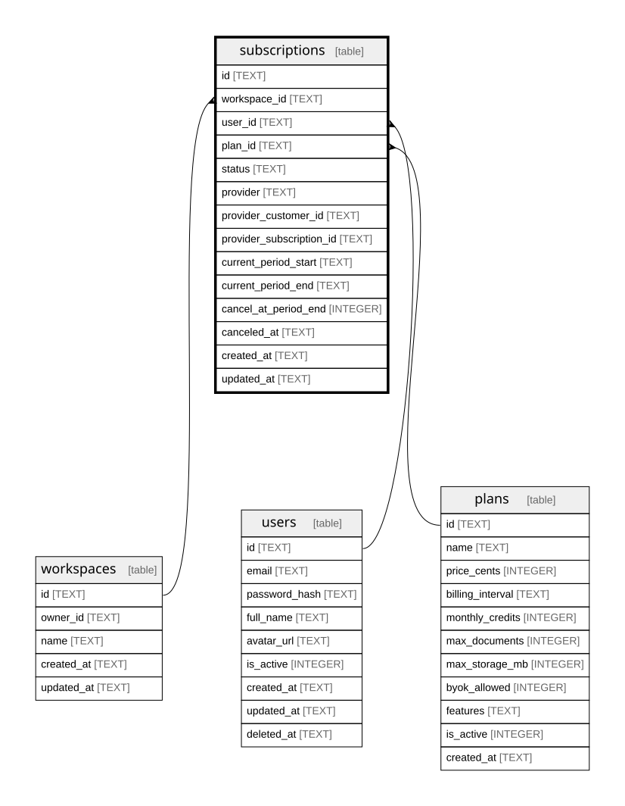

# subscriptions

## Description

<details>
<summary><strong>Table Definition</strong></summary>

```sql
CREATE TABLE subscriptions (
                id TEXT PRIMARY KEY,
                workspace_id TEXT NOT NULL,
                user_id TEXT,
                plan_id TEXT NOT NULL,
                status TEXT NOT NULL DEFAULT 'active'
                    CHECK (status IN ('active', 'trialing', 'past_due', 'canceled', 'expired')),
                provider TEXT NOT NULL DEFAULT 'stripe',
                provider_customer_id TEXT,
                provider_subscription_id TEXT UNIQUE,
                current_period_start TEXT NOT NULL,
                current_period_end TEXT NOT NULL,
                cancel_at_period_end INTEGER NOT NULL DEFAULT 0,
                canceled_at TEXT,
                created_at TEXT NOT NULL DEFAULT (strftime('%Y-%m-%dT%H:%M:%SZ', 'now')),
                updated_at TEXT NOT NULL DEFAULT (strftime('%Y-%m-%dT%H:%M:%SZ', 'now')),
                FOREIGN KEY (workspace_id) REFERENCES workspaces(id) ON DELETE CASCADE,
                FOREIGN KEY (user_id) REFERENCES users(id) ON DELETE SET NULL,
                FOREIGN KEY (plan_id) REFERENCES plans(id)
            )
```

</details>

## Columns

| Name                     | Type    | Default                               | Nullable | Children | Parents                     | Comment |
| ------------------------ | ------- | ------------------------------------- | -------- | -------- | --------------------------- | ------- |
| id                       | TEXT    |                                       | true     |          |                             |         |
| workspace_id             | TEXT    |                                       | false    |          | [workspaces](workspaces.md) |         |
| user_id                  | TEXT    |                                       | true     |          | [users](users.md)           |         |
| plan_id                  | TEXT    |                                       | false    |          | [plans](plans.md)           |         |
| status                   | TEXT    | 'active'                              | false    |          |                             |         |
| provider                 | TEXT    | 'stripe'                              | false    |          |                             |         |
| provider_customer_id     | TEXT    |                                       | true     |          |                             |         |
| provider_subscription_id | TEXT    |                                       | true     |          |                             |         |
| current_period_start     | TEXT    |                                       | false    |          |                             |         |
| current_period_end       | TEXT    |                                       | false    |          |                             |         |
| cancel_at_period_end     | INTEGER | 0                                     | false    |          |                             |         |
| canceled_at              | TEXT    |                                       | true     |          |                             |         |
| created_at               | TEXT    | strftime('%Y-%m-%dT%H:%M:%SZ', 'now') | false    |          |                             |         |
| updated_at               | TEXT    | strftime('%Y-%m-%dT%H:%M:%SZ', 'now') | false    |          |                             |         |

## Constraints

| Name                             | Type        | Definition                                                                                             |
| -------------------------------- | ----------- | ------------------------------------------------------------------------------------------------------ |
| id                               | PRIMARY KEY | PRIMARY KEY (id)                                                                                       |
| - (Foreign key ID: 0)            | FOREIGN KEY | FOREIGN KEY (plan_id) REFERENCES plans (id) ON UPDATE NO ACTION ON DELETE NO ACTION MATCH NONE         |
| - (Foreign key ID: 1)            | FOREIGN KEY | FOREIGN KEY (user_id) REFERENCES users (id) ON UPDATE NO ACTION ON DELETE SET NULL MATCH NONE          |
| - (Foreign key ID: 2)            | FOREIGN KEY | FOREIGN KEY (workspace_id) REFERENCES workspaces (id) ON UPDATE NO ACTION ON DELETE CASCADE MATCH NONE |
| sqlite_autoindex_subscriptions_2 | UNIQUE      | UNIQUE (provider_subscription_id)                                                                      |
| sqlite_autoindex_subscriptions_1 | PRIMARY KEY | PRIMARY KEY (id)                                                                                       |
| -                                | CHECK       | CHECK (status IN ('active', 'trialing', 'past_due', 'canceled', 'expired'))                            |

## Indexes

| Name                             | Definition                                                                         |
| -------------------------------- | ---------------------------------------------------------------------------------- |
| idx_subscriptions_provider       | CREATE INDEX idx_subscriptions_provider ON subscriptions(provider_subscription_id) |
| idx_subscriptions_ws             | CREATE INDEX idx_subscriptions_ws ON subscriptions(workspace_id, status)           |
| sqlite_autoindex_subscriptions_2 | UNIQUE (provider_subscription_id)                                                  |
| sqlite_autoindex_subscriptions_1 | PRIMARY KEY (id)                                                                   |

## Relations



---

> Generated by [tbls](https://github.com/k1LoW/tbls)
