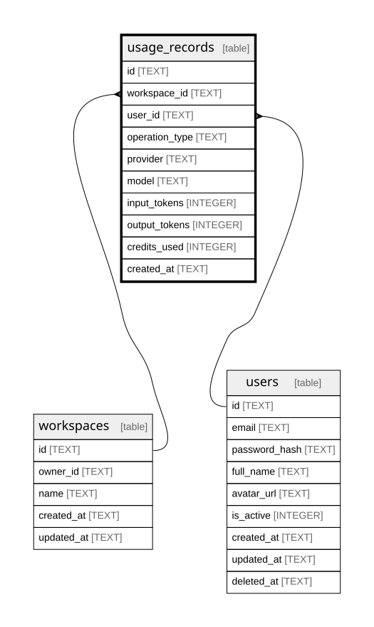

# usage_records

## Description

<details>
<summary><strong>Table Definition</strong></summary>

```sql
CREATE TABLE usage_records (
                id TEXT PRIMARY KEY,
                workspace_id TEXT NOT NULL,
                user_id TEXT NOT NULL,
                operation_type TEXT NOT NULL,
                provider TEXT NOT NULL,
                model TEXT NOT NULL,
                input_tokens INTEGER NOT NULL DEFAULT 0,
                output_tokens INTEGER NOT NULL DEFAULT 0,
                credits_used INTEGER NOT NULL DEFAULT 1,
                created_at TEXT NOT NULL DEFAULT (strftime('%Y-%m-%dT%H:%M:%SZ', 'now')),
                FOREIGN KEY (workspace_id) REFERENCES workspaces(id) ON DELETE CASCADE,
                FOREIGN KEY (user_id) REFERENCES users(id) ON DELETE CASCADE
            )
```

</details>

## Columns

| Name           | Type    | Default                               | Nullable | Children | Parents                     | Comment |
| -------------- | ------- | ------------------------------------- | -------- | -------- | --------------------------- | ------- |
| id             | TEXT    |                                       | true     |          |                             |         |
| workspace_id   | TEXT    |                                       | false    |          | [workspaces](workspaces.md) |         |
| user_id        | TEXT    |                                       | false    |          | [users](users.md)           |         |
| operation_type | TEXT    |                                       | false    |          |                             |         |
| provider       | TEXT    |                                       | false    |          |                             |         |
| model          | TEXT    |                                       | false    |          |                             |         |
| input_tokens   | INTEGER | 0                                     | false    |          |                             |         |
| output_tokens  | INTEGER | 0                                     | false    |          |                             |         |
| credits_used   | INTEGER | 1                                     | false    |          |                             |         |
| created_at     | TEXT    | strftime('%Y-%m-%dT%H:%M:%SZ', 'now') | false    |          |                             |         |

## Constraints

| Name                             | Type        | Definition                                                                                             |
| -------------------------------- | ----------- | ------------------------------------------------------------------------------------------------------ |
| id                               | PRIMARY KEY | PRIMARY KEY (id)                                                                                       |
| - (Foreign key ID: 0)            | FOREIGN KEY | FOREIGN KEY (user_id) REFERENCES users (id) ON UPDATE NO ACTION ON DELETE CASCADE MATCH NONE           |
| - (Foreign key ID: 1)            | FOREIGN KEY | FOREIGN KEY (workspace_id) REFERENCES workspaces (id) ON UPDATE NO ACTION ON DELETE CASCADE MATCH NONE |
| sqlite_autoindex_usage_records_1 | PRIMARY KEY | PRIMARY KEY (id)                                                                                       |

## Indexes

| Name                             | Definition                                                                   |
| -------------------------------- | ---------------------------------------------------------------------------- |
| idx_usage_records_ws             | CREATE INDEX idx_usage_records_ws ON usage_records(workspace_id, created_at) |
| sqlite_autoindex_usage_records_1 | PRIMARY KEY (id)                                                             |

## Relations



---

> Generated by [tbls](https://github.com/k1LoW/tbls)
