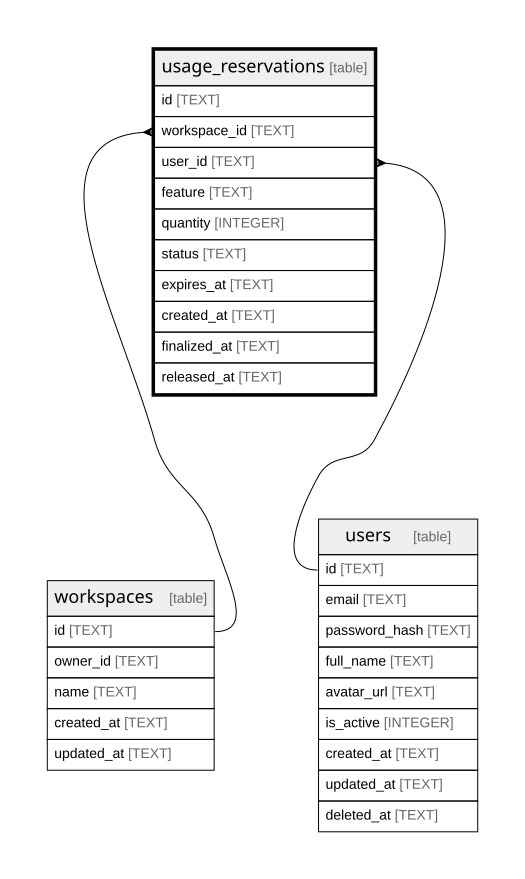

# usage_reservations

## Description

<details>
<summary><strong>Table Definition</strong></summary>

```sql
CREATE TABLE usage_reservations (
                id TEXT PRIMARY KEY,
                workspace_id TEXT NOT NULL,
                user_id TEXT NOT NULL,
                feature TEXT NOT NULL,
                quantity INTEGER NOT NULL DEFAULT 1,
                status TEXT NOT NULL DEFAULT 'pending'
                    CHECK (status IN ('pending', 'finalized', 'released', 'expired')),
                expires_at TEXT NOT NULL,
                created_at TEXT NOT NULL DEFAULT (strftime('%Y-%m-%dT%H:%M:%SZ', 'now')),
                finalized_at TEXT,
                released_at TEXT,
                FOREIGN KEY (workspace_id) REFERENCES workspaces(id) ON DELETE CASCADE,
                FOREIGN KEY (user_id) REFERENCES users(id) ON DELETE CASCADE
            )
```

</details>

## Columns

| Name         | Type    | Default                               | Nullable | Children | Parents                     | Comment |
| ------------ | ------- | ------------------------------------- | -------- | -------- | --------------------------- | ------- |
| id           | TEXT    |                                       | true     |          |                             |         |
| workspace_id | TEXT    |                                       | false    |          | [workspaces](workspaces.md) |         |
| user_id      | TEXT    |                                       | false    |          | [users](users.md)           |         |
| feature      | TEXT    |                                       | false    |          |                             |         |
| quantity     | INTEGER | 1                                     | false    |          |                             |         |
| status       | TEXT    | 'pending'                             | false    |          |                             |         |
| expires_at   | TEXT    |                                       | false    |          |                             |         |
| created_at   | TEXT    | strftime('%Y-%m-%dT%H:%M:%SZ', 'now') | false    |          |                             |         |
| finalized_at | TEXT    |                                       | true     |          |                             |         |
| released_at  | TEXT    |                                       | true     |          |                             |         |

## Constraints

| Name                                  | Type        | Definition                                                                                             |
| ------------------------------------- | ----------- | ------------------------------------------------------------------------------------------------------ |
| id                                    | PRIMARY KEY | PRIMARY KEY (id)                                                                                       |
| - (Foreign key ID: 0)                 | FOREIGN KEY | FOREIGN KEY (user_id) REFERENCES users (id) ON UPDATE NO ACTION ON DELETE CASCADE MATCH NONE           |
| - (Foreign key ID: 1)                 | FOREIGN KEY | FOREIGN KEY (workspace_id) REFERENCES workspaces (id) ON UPDATE NO ACTION ON DELETE CASCADE MATCH NONE |
| sqlite_autoindex_usage_reservations_1 | PRIMARY KEY | PRIMARY KEY (id)                                                                                       |
| -                                     | CHECK       | CHECK (status IN ('pending', 'finalized', 'released', 'expired'))                                      |

## Indexes

| Name                                  | Definition                                                                                      |
| ------------------------------------- | ----------------------------------------------------------------------------------------------- |
| idx_reservations_ws_status            | CREATE INDEX idx_reservations_ws_status ON usage_reservations(workspace_id, status, expires_at) |
| sqlite_autoindex_usage_reservations_1 | PRIMARY KEY (id)                                                                                |

## Relations



---

> Generated by [tbls](https://github.com/k1LoW/tbls)
