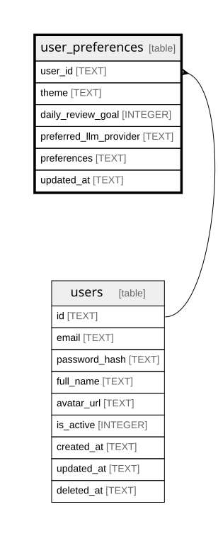

# user_preferences

## Description

<details>
<summary><strong>Table Definition</strong></summary>

```sql
CREATE TABLE user_preferences (
                user_id TEXT PRIMARY KEY,
                theme TEXT NOT NULL DEFAULT 'neo-brutalist',
                daily_review_goal INTEGER NOT NULL DEFAULT 20 CHECK (daily_review_goal > 0),
                preferred_llm_provider TEXT NOT NULL DEFAULT 'auto',
                preferences TEXT NOT NULL DEFAULT '{}',
                updated_at TEXT NOT NULL DEFAULT (strftime('%Y-%m-%dT%H:%M:%SZ', 'now')),
                FOREIGN KEY (user_id) REFERENCES users(id) ON DELETE CASCADE
            )
```

</details>

## Columns

| Name                   | Type    | Default                               | Nullable | Children | Parents           | Comment |
| ---------------------- | ------- | ------------------------------------- | -------- | -------- | ----------------- | ------- |
| user_id                | TEXT    |                                       | true     |          | [users](users.md) |         |
| theme                  | TEXT    | 'neo-brutalist'                       | false    |          |                   |         |
| daily_review_goal      | INTEGER | 20                                    | false    |          |                   |         |
| preferred_llm_provider | TEXT    | 'auto'                                | false    |          |                   |         |
| preferences            | TEXT    | '{}'                                  | false    |          |                   |         |
| updated_at             | TEXT    | strftime('%Y-%m-%dT%H:%M:%SZ', 'now') | false    |          |                   |         |

## Constraints

| Name                                | Type        | Definition                                                                                   |
| ----------------------------------- | ----------- | -------------------------------------------------------------------------------------------- |
| user_id                             | PRIMARY KEY | PRIMARY KEY (user_id)                                                                        |
| - (Foreign key ID: 0)               | FOREIGN KEY | FOREIGN KEY (user_id) REFERENCES users (id) ON UPDATE NO ACTION ON DELETE CASCADE MATCH NONE |
| sqlite_autoindex_user_preferences_1 | PRIMARY KEY | PRIMARY KEY (user_id)                                                                        |
| -                                   | CHECK       | CHECK (daily_review_goal > 0)                                                                |

## Indexes

| Name                                | Definition            |
| ----------------------------------- | --------------------- |
| sqlite_autoindex_user_preferences_1 | PRIMARY KEY (user_id) |

## Relations



---

> Generated by [tbls](https://github.com/k1LoW/tbls)
