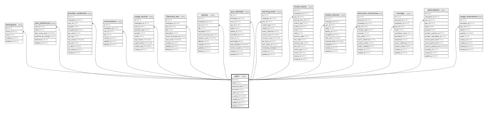

# users

## Description

<details>
<summary><strong>Table Definition</strong></summary>

```sql
CREATE TABLE users (
                id TEXT PRIMARY KEY,
                email TEXT NOT NULL UNIQUE COLLATE NOCASE,
                password_hash TEXT NOT NULL,
                full_name TEXT,
                avatar_url TEXT,
                is_active INTEGER NOT NULL DEFAULT 1,
                created_at TEXT NOT NULL DEFAULT (strftime('%Y-%m-%dT%H:%M:%SZ', 'now')),
                updated_at TEXT NOT NULL DEFAULT (strftime('%Y-%m-%dT%H:%M:%SZ', 'now')),
                deleted_at TEXT
            )
```

</details>

## Columns

| Name          | Type    | Default                               | Nullable | Children                                                                                                                                                                                                                                                                                                                                                                                                                                                                                                                                          | Parents | Comment |
| ------------- | ------- | ------------------------------------- | -------- | ------------------------------------------------------------------------------------------------------------------------------------------------------------------------------------------------------------------------------------------------------------------------------------------------------------------------------------------------------------------------------------------------------------------------------------------------------------------------------------------------------------------------------------------------- | ------- | ------- |
| id            | TEXT    |                                       | true     | [workspaces](workspaces.md) [user_preferences](user_preferences.md) [provider_credentials](provider_credentials.md) [conversations](conversations.md) [usage_records](usage_records.md) [flashcard_sets](flashcard_sets.md) [quizzes](quizzes.md) [quiz_attempts](quiz_attempts.md) [learning_items](learning_items.md) [review_events](review_events.md) [review_sessions](review_sessions.md) [document_summaries](document_summaries.md) [concepts](concepts.md) [subscriptions](subscriptions.md) [usage_reservations](usage_reservations.md) |         |         |
| email         | TEXT    |                                       | false    |                                                                                                                                                                                                                                                                                                                                                                                                                                                                                                                                                   |         |         |
| password_hash | TEXT    |                                       | false    |                                                                                                                                                                                                                                                                                                                                                                                                                                                                                                                                                   |         |         |
| full_name     | TEXT    |                                       | true     |                                                                                                                                                                                                                                                                                                                                                                                                                                                                                                                                                   |         |         |
| avatar_url    | TEXT    |                                       | true     |                                                                                                                                                                                                                                                                                                                                                                                                                                                                                                                                                   |         |         |
| is_active     | INTEGER | 1                                     | false    |                                                                                                                                                                                                                                                                                                                                                                                                                                                                                                                                                   |         |         |
| created_at    | TEXT    | strftime('%Y-%m-%dT%H:%M:%SZ', 'now') | false    |                                                                                                                                                                                                                                                                                                                                                                                                                                                                                                                                                   |         |         |
| updated_at    | TEXT    | strftime('%Y-%m-%dT%H:%M:%SZ', 'now') | false    |                                                                                                                                                                                                                                                                                                                                                                                                                                                                                                                                                   |         |         |
| deleted_at    | TEXT    |                                       | true     |                                                                                                                                                                                                                                                                                                                                                                                                                                                                                                                                                   |         |         |

## Constraints

| Name                     | Type        | Definition       |
| ------------------------ | ----------- | ---------------- |
| id                       | PRIMARY KEY | PRIMARY KEY (id) |
| sqlite_autoindex_users_2 | UNIQUE      | UNIQUE (email)   |
| sqlite_autoindex_users_1 | PRIMARY KEY | PRIMARY KEY (id) |

## Indexes

| Name                     | Definition                                   |
| ------------------------ | -------------------------------------------- |
| idx_users_email          | CREATE INDEX idx_users_email ON users(email) |
| sqlite_autoindex_users_2 | UNIQUE (email)                               |
| sqlite_autoindex_users_1 | PRIMARY KEY (id)                             |

## Relations



---

> Generated by [tbls](https://github.com/k1LoW/tbls)
