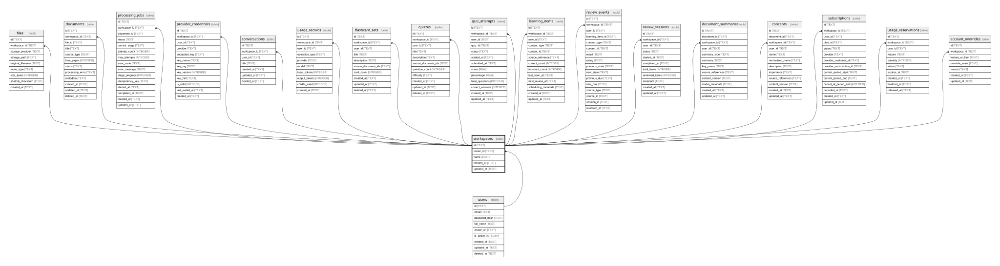

# workspaces

## Description

<details>
<summary><strong>Table Definition</strong></summary>

```sql
CREATE TABLE workspaces (
                id TEXT PRIMARY KEY,
                owner_id TEXT NOT NULL UNIQUE,
                name TEXT NOT NULL DEFAULT 'Personal Workspace',
                created_at TEXT NOT NULL DEFAULT (strftime('%Y-%m-%dT%H:%M:%SZ', 'now')),
                updated_at TEXT NOT NULL DEFAULT (strftime('%Y-%m-%dT%H:%M:%SZ', 'now')),
                FOREIGN KEY (owner_id) REFERENCES users(id) ON DELETE CASCADE
            )
```

</details>

## Columns

| Name       | Type | Default                               | Nullable | Children                                                                                                                                                                                                                                                                                                                                                                                                                                                                                                                                                                                                  | Parents           | Comment |
| ---------- | ---- | ------------------------------------- | -------- | --------------------------------------------------------------------------------------------------------------------------------------------------------------------------------------------------------------------------------------------------------------------------------------------------------------------------------------------------------------------------------------------------------------------------------------------------------------------------------------------------------------------------------------------------------------------------------------------------------- | ----------------- | ------- |
| id         | TEXT |                                       | true     | [files](files.md) [documents](documents.md) [processing_jobs](processing_jobs.md) [provider_credentials](provider_credentials.md) [conversations](conversations.md) [usage_records](usage_records.md) [flashcard_sets](flashcard_sets.md) [quizzes](quizzes.md) [quiz_attempts](quiz_attempts.md) [learning_items](learning_items.md) [review_events](review_events.md) [review_sessions](review_sessions.md) [document_summaries](document_summaries.md) [concepts](concepts.md) [subscriptions](subscriptions.md) [usage_reservations](usage_reservations.md) [account_overrides](account_overrides.md) |                   |         |
| owner_id   | TEXT |                                       | false    |                                                                                                                                                                                                                                                                                                                                                                                                                                                                                                                                                                                                           | [users](users.md) |         |
| name       | TEXT | 'Personal Workspace'                  | false    |                                                                                                                                                                                                                                                                                                                                                                                                                                                                                                                                                                                                           |                   |         |
| created_at | TEXT | strftime('%Y-%m-%dT%H:%M:%SZ', 'now') | false    |                                                                                                                                                                                                                                                                                                                                                                                                                                                                                                                                                                                                           |                   |         |
| updated_at | TEXT | strftime('%Y-%m-%dT%H:%M:%SZ', 'now') | false    |                                                                                                                                                                                                                                                                                                                                                                                                                                                                                                                                                                                                           |                   |         |

## Constraints

| Name                          | Type        | Definition                                                                                    |
| ----------------------------- | ----------- | --------------------------------------------------------------------------------------------- |
| id                            | PRIMARY KEY | PRIMARY KEY (id)                                                                              |
| - (Foreign key ID: 0)         | FOREIGN KEY | FOREIGN KEY (owner_id) REFERENCES users (id) ON UPDATE NO ACTION ON DELETE CASCADE MATCH NONE |
| sqlite_autoindex_workspaces_2 | UNIQUE      | UNIQUE (owner_id)                                                                             |
| sqlite_autoindex_workspaces_1 | PRIMARY KEY | PRIMARY KEY (id)                                                                              |

## Indexes

| Name                          | Definition                                                |
| ----------------------------- | --------------------------------------------------------- |
| idx_workspaces_owner          | CREATE INDEX idx_workspaces_owner ON workspaces(owner_id) |
| sqlite_autoindex_workspaces_2 | UNIQUE (owner_id)                                         |
| sqlite_autoindex_workspaces_1 | PRIMARY KEY (id)                                          |

## Relations



---

> Generated by [tbls](https://github.com/k1LoW/tbls)
