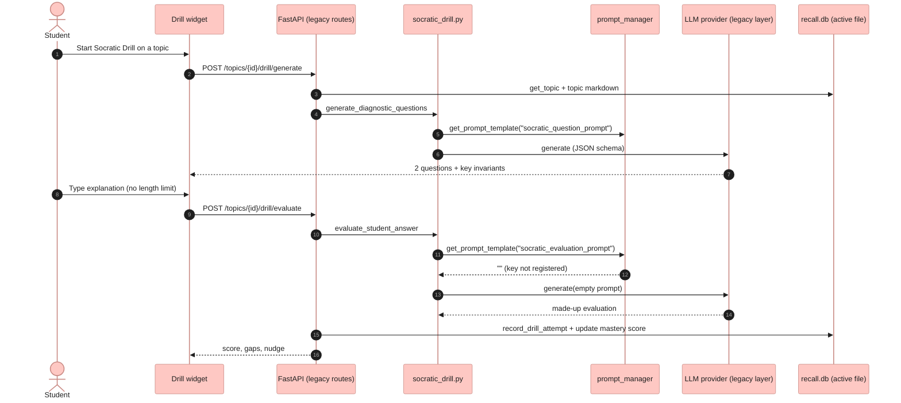

# 10 · Sequence: Socratic drill

Legacy endpoints `POST /topics/{id}/drill/generate` and `/drill/evaluate` (`app/main.py`, `app/socratic_drill.py`). No login check, and no plan limit.

**As built:** steps 11–14 are the grading bug. The evaluation prompt doesn't exist, so the score has nothing to do with the answer.

SVG export: [10-seq-socratic-drill.svg](10-seq-socratic-drill.svg)
