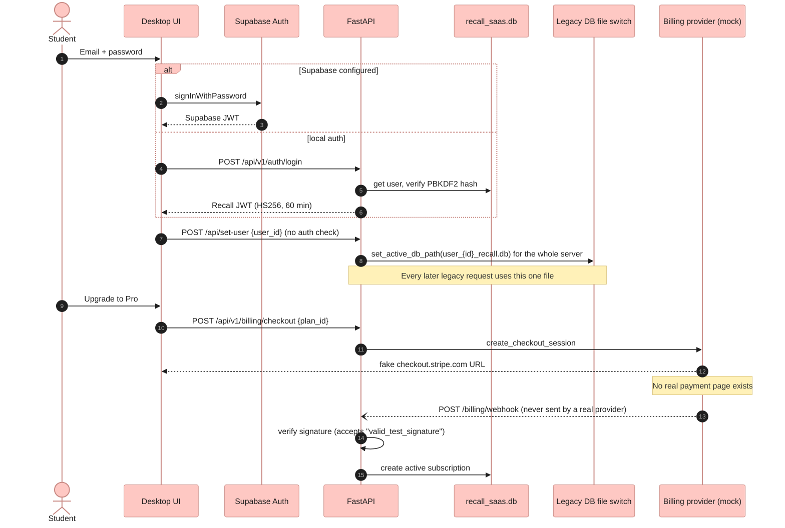

# 11 · Sequence: login and Premium upgrade

Login in `desktop/src/contexts/AuthProvider.tsx` → `/api/v1/auth/login` or Supabase, then `/api/set-user`. Upgrade via `/api/v1/billing/checkout` and `/billing/webhook` (`app/services/billing.py`).

**As built:** step 8 switches the legacy database for every user on the server, not only this one. Steps 13–15 can only complete through a forged webhook.

SVG export: [11-seq-login-upgrade.svg](11-seq-login-upgrade.svg)
