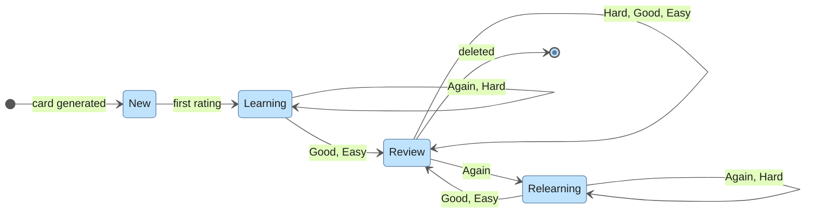
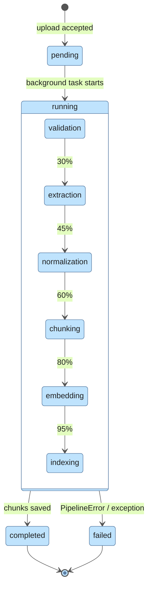
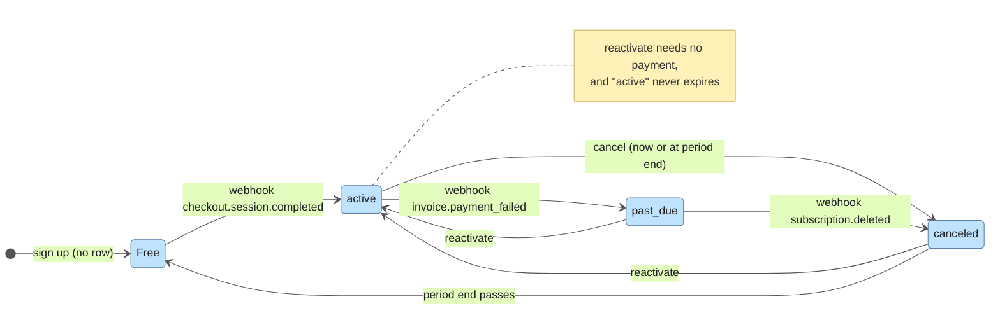

# 13 · State machine diagrams

Three objects with real states in the code.

## 13a · Flashcard (FSRS)

States from the `fsrs` library via `app/services/scheduler.py` (`FSRSScheduler`).

Learning steps are minutes apart (tested: Again → 1 min, Good → 10 min). In Review, each pass grows the interval (Easy → 8 days on first review). Again in Review counts a lapse.

## 13b · Document processing job

`ProcessingJobRepository` + `DocumentProcessingPipeline` (`app/services/pipeline.py`). The document's own status moves `uploading → processing → ready | failed` alongside.

## 13c · Subscription

`SubscriptionRepository` + `BillingService` (`app/services/billing.py`). Dashed note = as-built flaw.

SVG exports: [13a](13a-state-flashcard.svg) · [13b](13b-state-processing-job.svg) · [13c](13c-state-subscription.svg)
