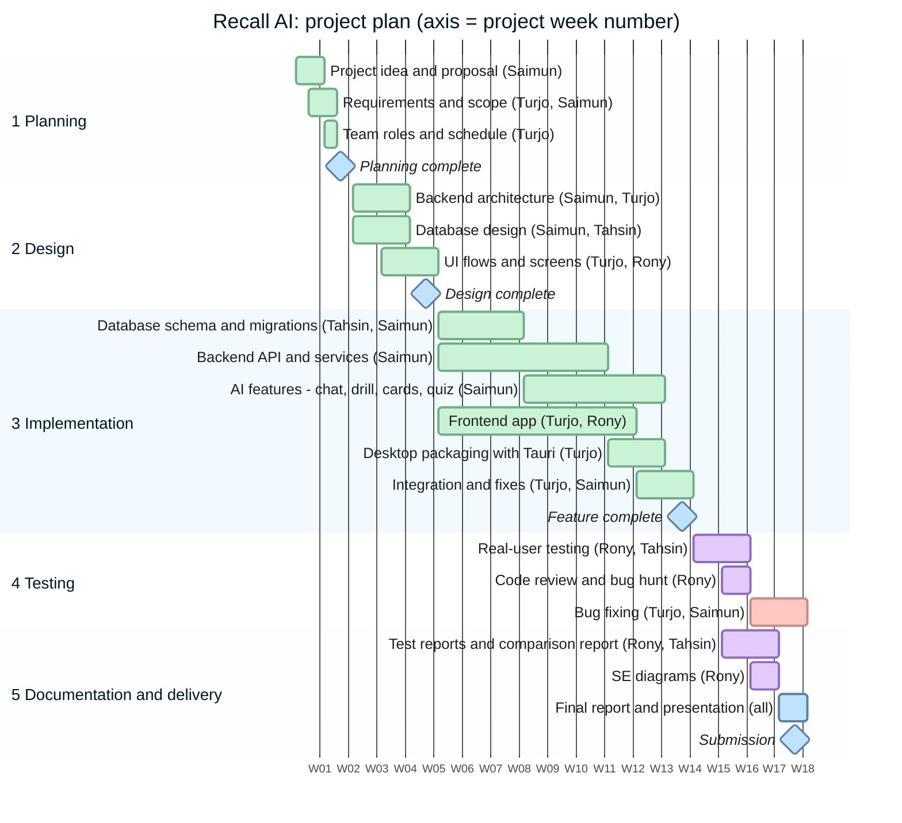

# 14 · Gantt chart: team plan

Team of four: **Turjo** (team lead, frontend), **Saimun** (project idea, backend), **Tahsin** (database, testing, docs), **Rony** (frontend support, testing, docs). The timeline is in project weeks, not calendar dates.

Colours: green = done, purple = in progress, pink = critical (bug fixing must finish before submission), blue = upcoming.

SVG export: [14-gantt-team-plan.svg](14-gantt-team-plan.svg)
