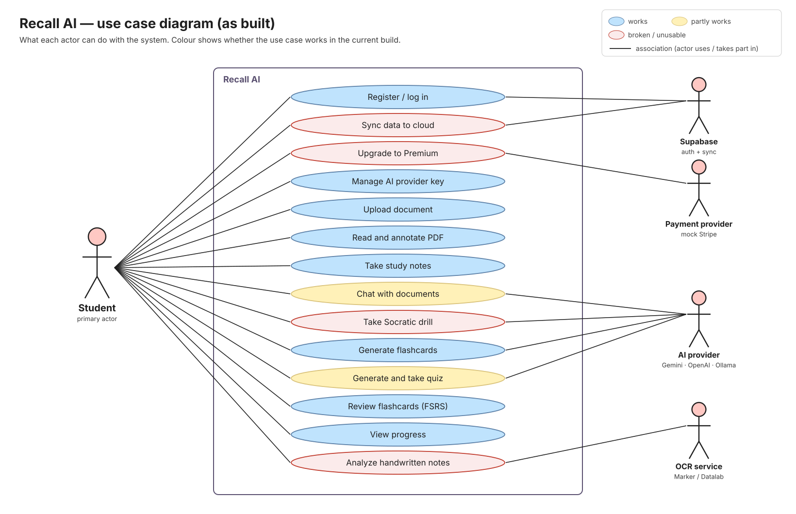
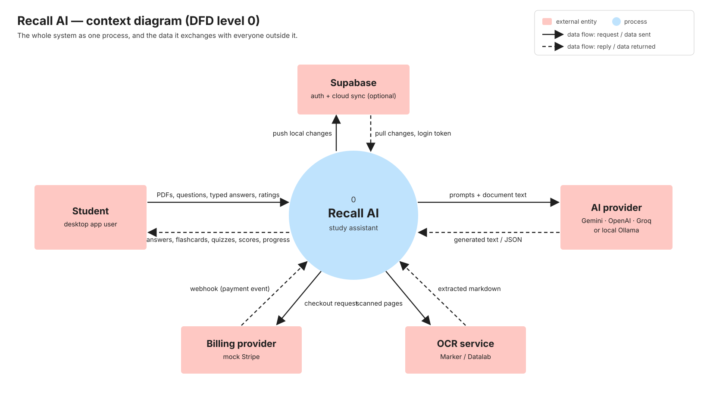
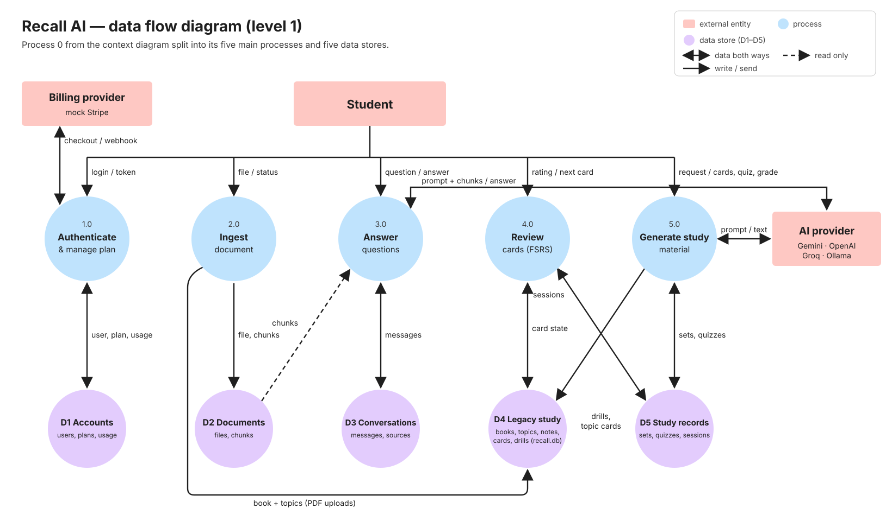
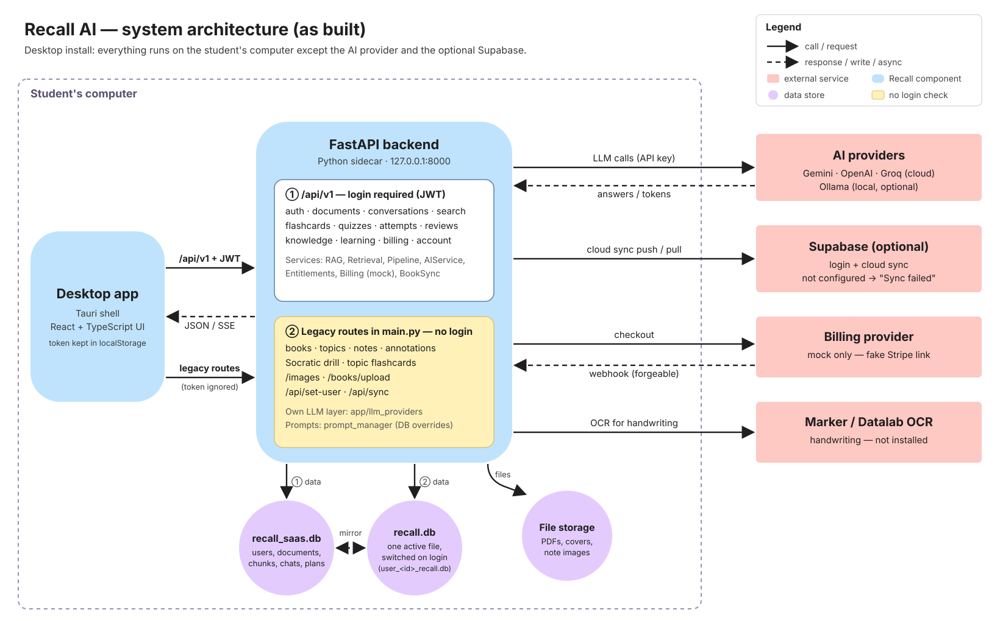
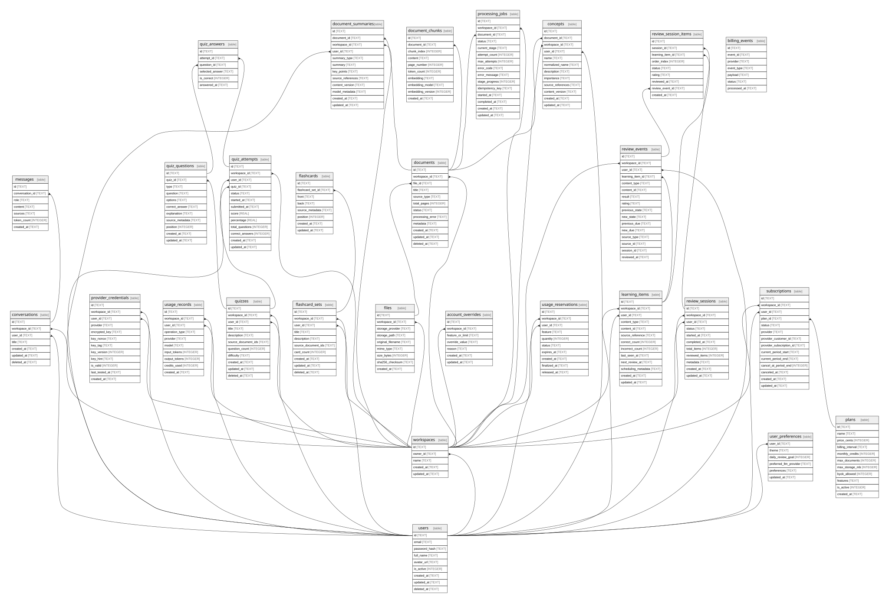
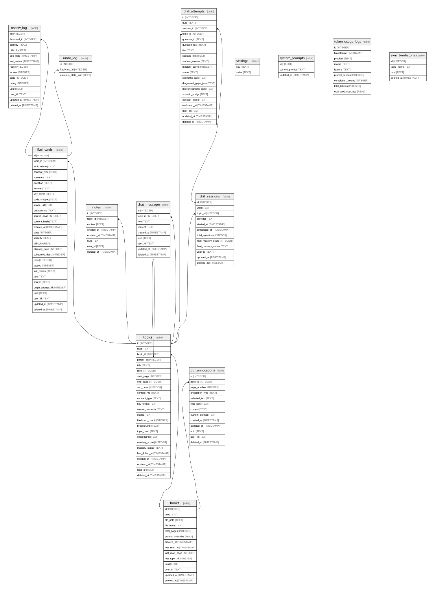
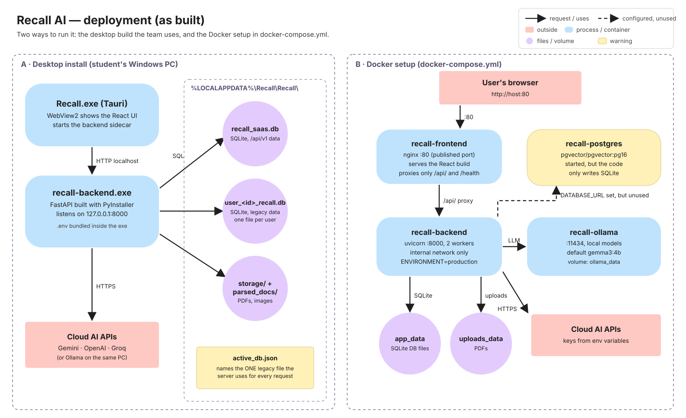

# Recall AI: SDLC diagrams

Diagrams of Recall AI **as it is actually built**, traced from the code (commit `9d47554` plus local changes). Where the code differs from the intended design, the diagram shows the code and marks the gap.

Team: Turjo (lead, frontend), Saimun (idea, backend), Tahsin (database, testing, docs), Rony (frontend support, testing, docs).

| # | Diagram | SDLC phase | File | Tool |
| --- | --- | --- | --- | --- |
| 1 | Use case | Requirements | [01-use-case.svg](01-use-case.svg) | hand-drawn SVG |
| 2 | Context (DFD level 0) | Requirements | [02-context-dfd-level0.svg](02-context-dfd-level0.svg) | hand-drawn SVG |
| 3 | Data flow (DFD level 1) | Analysis | [03-dfd-level1.svg](03-dfd-level1.svg) | hand-drawn SVG |
| 4 | System architecture | Design | [04-system-architecture.svg](04-system-architecture.svg) | hand-drawn SVG |
| 5 | Deployment | Deployment | [05-deployment.svg](05-deployment.svg) | hand-drawn SVG |
| 6a | ER: SaaS database (29 tables) | Design | [../database/saas/README.md](../database/saas/README.md) | tbls (generated) |
| 6b | ER: legacy study database (14 tables) | Design | [../database/legacy/README.md](../database/legacy/README.md) | tbls (generated) |
| 7a | Class: chat, search, AI | Design | [07a-class-chat-ai.md](07a-class-chat-ai.md) | Mermaid |
| 7b | Class: document processing | Design | [07b-class-documents.md](07b-class-documents.md) | Mermaid |
| 7c | Class: study features, billing | Design | [07c-class-study-billing.md](07c-class-study-billing.md) | Mermaid |
| 8 | Sequence: upload a PDF | Design | [08-seq-upload-document.md](08-seq-upload-document.md) | Mermaid |
| 9 | Sequence: chat | Design | [09-seq-chat.md](09-seq-chat.md) | Mermaid |
| 10 | Sequence: Socratic drill | Design | [10-seq-socratic-drill.md](10-seq-socratic-drill.md) | Mermaid |
| 11 | Sequence: login + upgrade | Design | [11-seq-login-upgrade.md](11-seq-login-upgrade.md) | Mermaid |
| 12 | Activity: study workflow | Analysis | [12-activity-study-workflow.md](12-activity-study-workflow.md) | Mermaid |
| 13 | State machines: flashcard, job, subscription | Design | [13-state-machines.md](13-state-machines.md) | Mermaid |
| 14 | Gantt: team plan | Planning | [14-gantt-team-plan.md](14-gantt-team-plan.md) | Mermaid |

Every Mermaid file also has a light-theme `.svg` export with the same name.

**Two versions:** the files in this folder are the coloured versions. [`bw/`](bw/) has the same diagrams in black and white (diagrams 1–13, plus `06a`/`06b` for the ER diagrams), where line style replaces colour: dashed or dotted borders mark warnings and broken parts. [Recall-AI-SDLC-Diagrams.docx](Recall-AI-SDLC-Diagrams.docx) has all 18 black-and-white diagrams, one per page, each with a one-line title.

## Requirements and analysis







## Design







## Deployment



## As-built facts the diagrams show

- **Two databases.** `/api/v1` uses `recall_saas.db`; the older study features use `recall.db`. Books are copied between them.
- **One legacy database file for the whole server.** Logging in switches the active `user_<id>_recall.db` for every request.
- **Legacy routes have no login check.** They include the drill, notes, annotations, `/images` and `/api/set-user`.
- **Search embeddings are hash values**, not AI vectors.
- **Billing is mock-only.** The webhook accepts a hardcoded test signature.
- **The Docker setup starts Postgres, but the code only writes SQLite.** nginx exposes only `/api/` and `/health`.

## Regenerating

**ER diagrams** (read-only, run against a copy of each SQLite file, Docker required):

```bash
docker run --rm -v "$PWD:/work" -v "<folder with db copies>:/db" -w /work ghcr.io/k1low/tbls:v1.96.1 doc --rm-dist -c docs/database/tbls.saas.yml sq:///db/recall_saas.db
```

Use `tbls.legacy.yml` with `recall.db` for the legacy database.

**Mermaid SVGs:** each `.md` holds the source. Export with [Mermaid CLI](https://github.com/mermaid-js/mermaid-cli) (`mmdc -b white -i <file>.mmd -o <file>.svg`). The theme is set inside each diagram, so exports stay light.
