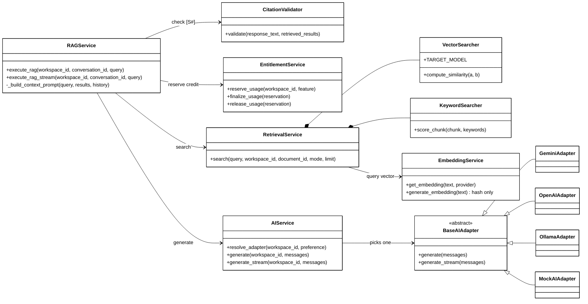

# 07a · Class diagram: chat, search and AI providers

How a chat answer is produced (`app/services/rag.py`, `retrieval.py`, `embedding.py`, `ai/`).

**As built:** search calls `generate_embedding`, which always returns a hash-based vector, not the AI model. `AIService` falls back to `MockAIAdapter` when no key is found. OpenAI and Groq both use `OpenAIAdapter`.

SVG export (black and white): [07a-class-chat-ai.svg](07a-class-chat-ai.svg)
