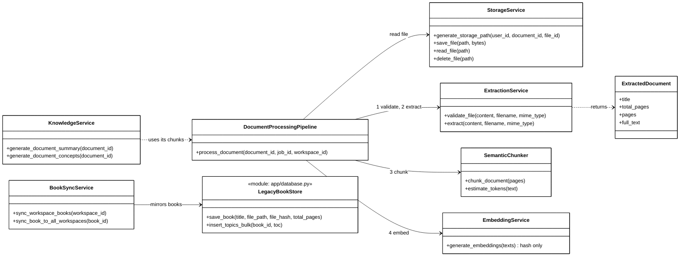

# 07b · Class diagram: document upload and processing

What happens to a file after upload (`app/services/pipeline.py`, `extractor.py`, `chunker.py`, `storage.py`, `book_sync.py`).

**As built:** a PDF upload also writes a book and topics to the legacy database (`LegacyBookStore`), and `BookSyncService` copies books between the two databases.

SVG export (black and white): [07b-class-documents.svg](07b-class-documents.svg)
