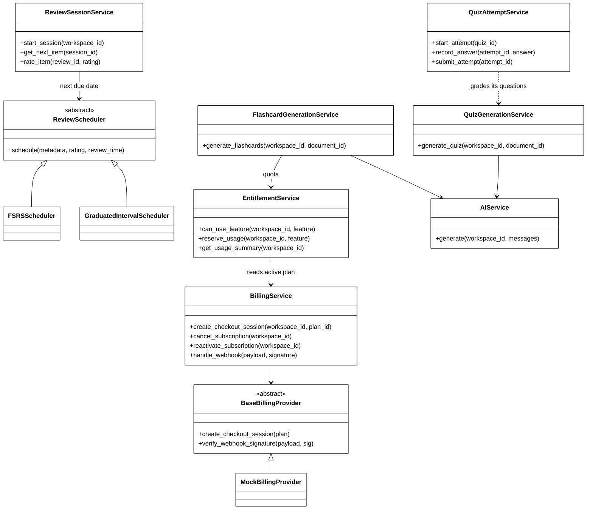

# 07c · Class diagram: study features and billing

Flashcards, quizzes, spaced review, plan limits and billing (`app/services/flashcards.py`, `quizzes.py`, `attempts.py`, `reviews.py`, `scheduler.py`, `entitlements.py`, `billing.py`).

**As built:** `MockBillingProvider` is the only provider, so no real payment is possible. The legacy drill and topic-flashcard endpoints in `app/main.py` don't use these classes or `EntitlementService`.

SVG export (black and white): [07c-class-study-billing.svg](07c-class-study-billing.svg)
