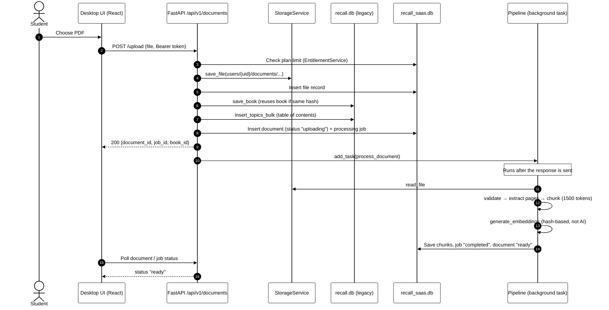

# 08 · Sequence: upload a PDF

`POST /api/v1/documents/upload` (`app/api/v1/documents.py`), then the background pipeline (`app/services/pipeline.py`).

**As built:** step 6 links the upload to an existing book with the same file hash, even one owned by another user. Step 13's embeddings are not from an AI model.

SVG export (black and white): [08-seq-upload-document.svg](08-seq-upload-document.svg)
