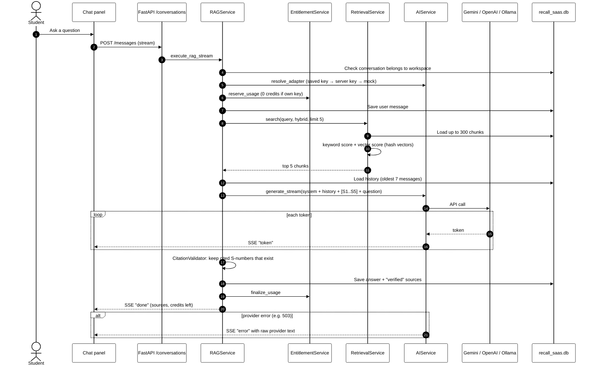

# 09 · Sequence: chat with your documents

`POST /api/v1/conversations/{id}/messages` → `RAGService.execute_rag_stream` (`app/services/rag.py`).

**As built:** step 12 loads the oldest messages, not the latest. Step 17 marks a source "verified" if its S-number exists, not if it supports the answer.

SVG export (black and white): [09-seq-chat.svg](09-seq-chat.svg)
